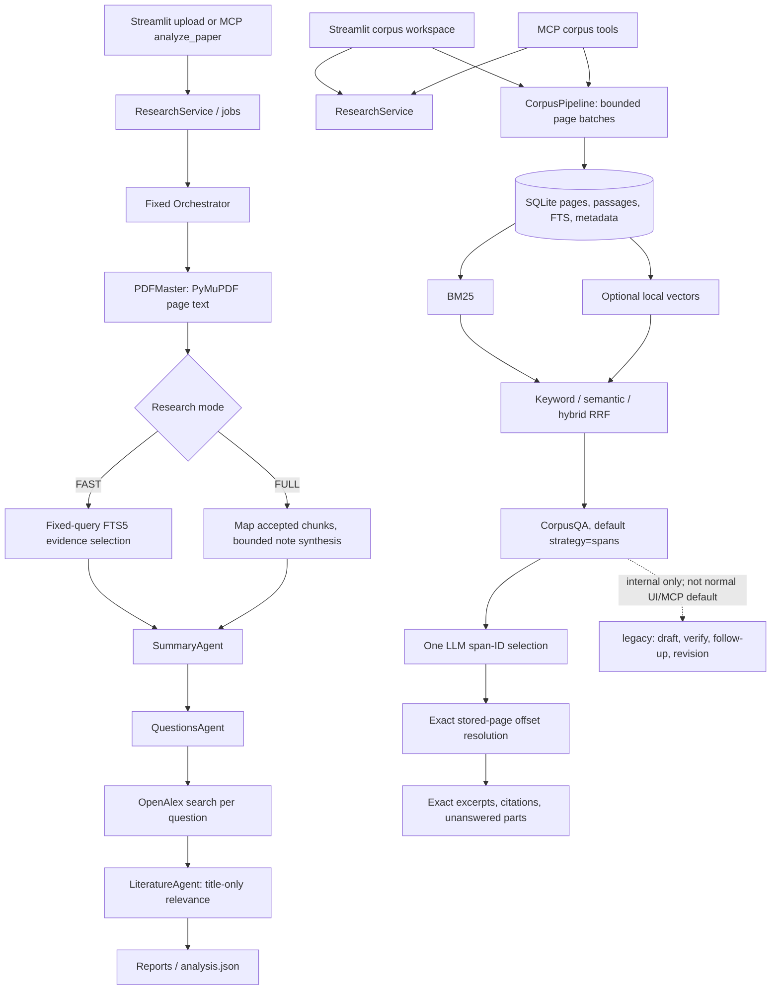

# Current Project Technical Assessment

**Assessment timestamp:** 2026-11-18 23:10 +02:00  
**Scope:** Current repository source, configuration templates, and saved live/test artifacts. No application code, prompts, tests, labels, or experiment outputs were changed.

## Evidence labels

- **VERIFIED BY LIVE EXECUTION** — recorded in a named runtime artifact; not necessarily rerun in this assessment.
- **VERIFIED BY SOURCE CODE** — directly visible in current source or checked-in configuration template.
- **HISTORICAL EVIDENCE** — a previous report or run; do not treat as current runtime state.
- **HYPOTHESIS** — plausible explanation or proposal that still needs a controlled test.
- **UNKNOWN** — repository evidence does not establish the fact.
- **NOT IMPLEMENTED** — absent from the current runtime path.

The private `.env` and current live hardware/process state were not inspected. Values from `.env.example`, README history, and saved probes are identified as such; they are not silently presented as the current active environment. The latest saved test JUnit is dated 2026-11-18 21:48:23 +02:00, before this assessment. No fresh test suite or model inference was run here.

## 1. Current architecture

### 1.1 What is the exact current repository structure?

**[VERIFIED BY SOURCE CODE / filesystem view]** The project root contains:

```text
agents/                     Four specialist implementations
research_swarm/             Service, MCP, jobs/dashboard, prompts, budgets, telemetry
research_swarm/corpus/      Corpus ingestion, SQLite store, retrieval, span QA, UI, CLI
tools/                      OpenAlex client and Ollama benchmark helper
  files: __main__.py, ui.py, store.py, spans.py, retrieval.py, qa.py,
         ingest.py, config.py, __init__.py
tests/                      12 Python test modules:
  test_audit_regressions.py, test_configuration.py, test_corpus.py,
  test_corpus_qa.py, test_dashboard.py, test_evaluation.py, test_mcp.py,
  test_performance_modes.py, test_prompts.py, test_providers.py,
  test_ui.py, test_workflow.py
prompts/
  baseline/                 18 Markdown prompt files
  evidence/                 5 Markdown prompt files
  fields/                   4 Markdown prompt files
  README.md, selection.json
evaluation/                 Runners, scoring, acceptance, benchmark and report builders
evaluation/results/         Saved experiments, acceptance outputs and test reports
audit/                      RAG assessments, gap analysis, roadmap, target design
docs/                       Professor requirements, architecture, RAG, MCP and evaluation docs
  ARCHITECTURE.md, FINAL_IMPLEMENTATION_REPORT.md, MCP_GUIDE.md,
  PROFESSOR_REQUIREMENTS.md, PROMPT_ENGINEERING.md, RAG_PIPELINE.md,
  SCIENTIFIC_EVALUATION.md, WINDOWS_RUN_GUIDE.md
deCitit/                    Local PDF storage root used by corpus configuration
research/                   Local research/corpus data root
output/                     Generated reports and saved run output
app.py                      Streamlit entry point
orchestrator.py             Existing fixed specialist workflow
config.py, models.py        Settings and Pydantic contracts
llm.py, providers.py        LLM facade and Ollama/optional OpenAI/test providers
cache.py                    Local response cache
requirements*.txt           Core, MCP SDK, optional OpenAI dependencies
```

The four files under `agents/` are `pdf_master.py`, `summary_agent.py`,
`questions_agent.py`, and `literature_agent.py`. The `research_swarm/` service
modules include `mcp_server.py`, `service.py`, `jobs.py`, `dashboard.py`,
`summary_work.py`, `prompt_loader.py`, `telemetry.py`, `budgets.py`, and
`__init__.py`. `tools/` contains `openalex.py` and `benchmark_ollama.py`.
`evaluation/` contains acceptance, prompt/retrieval/span benchmark, scoring,
smoke, verification, report-building, and environment-probe scripts plus saved
results. The `audit/` and top-level docs contain historical reports as well as
current assessments; they are not all runtime components.

Root-level Python sources are `app.py`, `orchestrator.py`, `config.py`,
`models.py`, `llm.py`, `providers.py`, and `cache.py`. Root-level Markdown
reports include `ABLATION_STUDY.md`, `AUDIT_REPORT.md`,
`FINAL_ACCEPTANCE_REPORT.md`, `FINAL_AUDIT_REPORT.md`,
`FINAL_EXPERIMENT_RESULTS.md`, `IMPLEMENTATION_REPORT.md`,
`IMPLEMENTATION_STATUS.md`, `LOCAL_LLM_REPORT.md`, `MCP_GUIDE.md`,
`MCP_INTEGRATION_GUIDE.md`, `MODEL_COMPARISON.md`, `OLLAMA_BENCHMARK.md`,
`PERFORMANCE_REPORT.md`, `PROFESSOR_DEMONSTRATION.md`,
`PROFESSOR_DEMO_GUIDE.md`, `PROGRESS_DASHBOARD.md`, `PROMPT_EXPERIMENTS.md`,
`README.md`, `RESEARCH_PLATFORM_PLAN.md`, `RETRIEVAL_EXPERIMENTS.md`,
`SCIENTIFIC_BENCHMARK.md`, `SCIENTIFIC_QUALITY_REPORT.md`,
`SYSTEM_ARCHITECTURE.md`, and `WINDOWS_RUN_GUIDE.md`.

The workspace also contains `.git`, `.env`, `.cache`, `.runtime`, `.uv-cache`, `.venv`, `.venv-swarm`, `.pytest_cache`, and `.vscode`. These are present in the filesystem view, but this audit did not establish which are tracked by Git. The private `.env` contents were not read. A full file-by-file tree would include large local runtimes, caches, virtual environments, PDFs, and generated artifacts; those are not application source structure.

Key source files: [app.py](app.py), [orchestrator.py](orchestrator.py), [agents/](agents), [research_swarm/](research_swarm), [evaluation/](evaluation), [tests/](tests), [prompts/](prompts), [audit/](audit).

### 1.2 What is the complete production data flow from PDF upload to scientific answer?

**[VERIFIED BY SOURCE CODE]** There are two distinct user journeys; the normal upload-and-analyze workflow does not itself expose an interactive question-answer box.

1. **Single-paper Streamlit/MCP analysis:** PDF upload/path → bounded PDF bytes → `PDFMaster.extract` (PyMuPDF page text) → `Orchestrator` → FAST selects bounded evidence using the existing SQLite/FTS selector, or FULL maps accepted text chunks and synthesizes notes → `SummaryAgent` → `QuestionsAgent` → OpenAlex metadata search per generated question → `LiteratureAgent` assesses returned titles only → reports/typed result and saved run files. Streamlit starts the worker through `research_swarm.jobs`; MCP `analyze_paper` calls the same `ResearchService.analyze`/`Orchestrator` family. Sources: [app.py](app.py), [orchestrator.py](orchestrator.py), [summary_work.py](research_swarm/summary_work.py), [service.py](research_swarm/service.py).
2. **Persistent corpus QA:** register one or more operator-supplied PDFs → resumable, bounded page extraction → SQLite pages/passages/metadata and FTS indexing → optionally index local embeddings → user chooses scope and keyword/semantic/hybrid mode → `CorpusQA` decomposes the question, retrieves per part, heuristically ranks candidate sentences, packs span IDs into a bounded prompt → one model selects IDs → server resolves exact offsets against stored page text → response contains source excerpts/citations and unanswered parts. Sources: [corpus UI](research_swarm/corpus/ui.py), [ingest](research_swarm/corpus/ingest.py), [retrieval](research_swarm/corpus/retrieval.py), [QA](research_swarm/corpus/qa.py).

### 1.3 Which components are fully implemented, partially implemented, or unused?

**[VERIFIED BY SOURCE CODE]**

| State | Components |
|---|---|
| Implemented for documented limits | Readable-PDF extraction; persistent SQLite corpus; page/passages and exact offsets; FTS5/BM25; optional Ollama embeddings and semantic retrieval; hybrid RRF; external Markdown prompt loader; fixed specialist workflow; 11 MCP tools; bounded request/document budgets; local response cache. |
| Partial / quality not established | PDF layout/table/formula processing; automatic bibliographic metadata; FAST context selection; default QA relevance/support checking; citation entailment; research-question usefulness; cross-paper answer completeness; observability; scientific benchmark breadth. |
| Exists but not selected by normal callers | `CorpusQA(strategy="legacy")`: draft/verify/follow-up/revision path. |
| Not implemented | OCR; PDF image/figure understanding; full-text literature retrieval/verification; dynamic specialist/tool routing; public user-facing QA feedback loop; durable query-level QA result/validation record; authenticated remote MCP service. |
| Not used by default | Semantic and hybrid modes are not the default QA mode; default is keyword. The optional OpenAI provider is disabled unless explicitly opted in. |

### 1.4 Provide a Mermaid diagram of the actual architecture.

**[VERIFIED BY SOURCE CODE]**



### 1.5 Do Streamlit and MCP use exactly the same RAG pipeline?

**[VERIFIED BY SOURCE CODE]** Not exactly. For corpus QA they share `ResearchService.ask_corpus` → `CorpusQA` → `EvidenceRetrieval` and use the same persistent corpus implementation; both default to keyword mode and span QA unless options are provided. Streamlit additionally exposes manual batch processing, optional embedding indexing, and UI scope/mode controls. MCP exposes those operations as separate tools. The main Streamlit upload workflow and MCP `analyze_paper` share the fixed Orchestrator family, but that is distinct from corpus QA. Neither UI nor the MCP question tool exposes `strategy="legacy"`. See [corpus UI](research_swarm/corpus/ui.py), [MCP server](research_swarm/mcp_server.py), [service](research_swarm/service.py).

## 2. Models and hardware

### 2.1 What CPU, GPU, RAM, and VRAM are available?

- **[HISTORICAL EVIDENCE] CPU:** README records an AMD Ryzen 7 5800H, 8 cores / 16 logical processors, from an earlier inspection. It is not in the latest hardware snapshot.
- **[VERIFIED BY LIVE EXECUTION, saved probe] GPU/VRAM:** NVIDIA GeForce RTX 3050 Ti Laptop GPU; 4,096 MiB total, 958 MiB free in the saved `span-engineering-release` hardware snapshot.
- **[VERIFIED BY LIVE EXECUTION, saved probe] RAM:** 15.41 GiB total, 1.35 GiB available in that same snapshot.
- **[UNKNOWN] Current available CPU/RAM/VRAM:** these are not live readings at this assessment timestamp. Hardware artifact: [hardware.txt](evaluation/results/span-engineering-release/hardware.txt); historical CPU source: [README hardware section](README.md).

### 2.2 Which Ollama models are currently installed?

**[VERIFIED BY LIVE EXECUTION, saved probe; current installation UNKNOWN]** The latest saved `ollama list` showed:

| Tag | Saved ID prefix | Saved size |
|---|---|---:|
| `llama3.2:latest` | `a80c4f17acd5` | 2.0 GB |
| `all-minilm:latest` | `1b226e2802db` | 45 MB |

That saved process snapshot showed `llama3.2:latest` running. No fresh `ollama list` was run, so these are the latest recorded models, not a guarantee of current installation.

### 2.3 Which model does each agent actually use?

**[VERIFIED BY SOURCE CODE]** `PDFMaster` is deterministic and uses no LLM. Summary, Questions, and Literature agents share the `LLM` instance built from `Settings` in the Orchestrator. Corpus QA constructs an `LLM` from the same settings. Thus the generation model is configuration-wide, not a different model per specialist. The latest saved live run used local `llama3.2:latest` with digest prefix `a80c4f17acd5`; current active `.env`/process configuration was not inspected. The embedding model is separate; see 2.4. Sources: [Orchestrator](orchestrator.py), [LLM](llm.py), [Settings](config.py), [CorpusQA](research_swarm/corpus/qa.py).

### 2.4 Which embedding model is used?

**[VERIFIED BY SOURCE CODE]** `all-minilm:latest` by default, configured by `CORPUS_EMBEDDING_MODEL`; `.env.example` sets `CORPUS_EMBEDDING_CONTEXT=512`. Embedding calls go to local Ollama `/api/embed`, pool 120-character UTF-8 byte segments, normalize vectors, and store float32 vectors in SQLite by model identity. Embeddings are optional and must be indexed before semantic/hybrid search. Sources: [CorpusConfig](research_swarm/corpus/config.py), [LocalEmbeddings](research_swarm/corpus/retrieval.py).

### 2.5 What are the context window, temperature, token limits, and timeout settings?

**[VERIFIED BY SOURCE CODE / checked-in template; active `.env` UNKNOWN]**

| Setting | Default / template value | Notes |
|---|---:|---|
| Ollama context (`OLLAMA_CONTEXT_TOKENS`) | 8,192 | Sent as `options.num_ctx`; summary context defaults to 8,192. |
| Temperature | 0 | Explicit for Ollama; optional OpenAI provider also sets 0. |
| General max output (`LLM_MAX_OUTPUT_TOKENS`) | 1,200 | General structured/text requests. |
| Summary max output | 256 | Summary call passes its own smaller output cap. |
| Default chunk budget (`CHUNK_TOKENS`) | 2,000 bytes | Despite the legacy name, it is a conservative UTF-8 byte budget, not exact tokens. |
| Summary chunk budget | 2,000 bytes | `chunk_tokens`; FULL caps at 32 chunks by default. |
| LLM timeout | 90 s in `.env.example` and `Settings` default | README's historical setup example says 300 s; active private `.env` is unknown. Acceptance harnesses also used explicit 45/90 s overrides. |
| Document timeout | 600 s in `.env.example` / `Settings` | Encloses a whole operation. |
| Corpus embedding context | 512 | Separate from generation context. |
| Corpus QA output | 256 tokens | Default span strategy calls `LLM.run(... max_output_tokens=256)`. |

Sources: [`.env.example`](.env.example), [Settings](config.py), [Ollama provider](providers.py), [SummaryAgent](agents/summary_agent.py), [CorpusQA](research_swarm/corpus/qa.py).

### 2.6 Is inference running on CPU or GPU?

**[VERIFIED BY LIVE EXECUTION, saved probe]** The latest saved `ollama ps` reported `100% GPU`, context 8,192, for `llama3.2:latest`. This answers where that saved run executed; **current placement is UNKNOWN**. The project template leaves `OLLAMA_GPU_LAYERS` unset for automatic placement, while the historical local report says the private `.env` had an explicit GPU layer setting. The private file was not inspected.

### 2.7 Is the current model the main limitation? What experimental evidence supports this conclusion?

**[UNKNOWN; HYPOTHESIS]** The model may constrain relevance/interpretation and latency, but the repository does not isolate it as the primary cause: only one generation model was available in the saved probe and no controlled cross-model accuracy comparison was run. With the same Llama 3.2, constrained span selection improved over the older free-form/legacy QA behavior, demonstrating that output contract and validation path matter. The latest span review still had one wrong and one partial answer. Retrieval/context selection also produced an off-target excerpt. The defensible conclusion is that this is a **system-level quality problem**, not a proven model-only limitation. See [model suitability](MODEL_COMPARISON.md), [prompt experiments](PROMPT_EXPERIMENTS.md), [quality review](evaluation/results/span-engineering-release/review.json).

## 3. Retrieval

### 3.1 How exactly are scientific PDFs parsed and chunked?

**[VERIFIED BY SOURCE CODE]** `PDFMaster` opens bytes with PyMuPDF, rejects encrypted/invalid/over-limit files, extracts `page.get_text("text", sort=True)` and retains physical page numbers; empty pages generate warnings. Corpus ingestion separately validates and hashes the PDF, then processes resumable page batches. Passages prefer paragraph breaks, stop at heuristic headings, and use hard character bounds; section names are inferred by a regular expression. There is no OCR or structured table/formula parser. Sources: [PDFMaster](agents/pdf_master.py), [corpus ingestion](research_swarm/corpus/ingest.py).

### 3.2 What are the chunk size and overlap?

**[VERIFIED BY SOURCE CODE]** Corpus passages default to **1,200 characters with 120-character overlap** (`CORPUS_PASSAGE_CHARS`, `CORPUS_OVERLAP_CHARS`). Original summary chunks default to **2,000 UTF-8 bytes**, not tokenizer tokens; those are a separate pipeline. `.env.example` records both. [CorpusConfig](research_swarm/corpus/config.py) · [Settings](config.py).

### 3.3 How are chunks and embeddings stored?

**[VERIFIED BY SOURCE CODE]** SQLite stores publication/document metadata, exact page text, passage text, page number, character start/end and section. FTS5 indexes passage text via triggers. Optional vectors are float32 blobs keyed by passage ID and embedding-model identity, with dimensions stored and checked. PDFs are kept under the corpus PDF root by SHA-256 filename. [CorpusStore](research_swarm/corpus/store.py) · [ingest](research_swarm/corpus/ingest.py) · [retrieval](research_swarm/corpus/retrieval.py).

### 3.4 How does BM25 retrieval work?

**[VERIFIED BY SOURCE CODE]** It extracts up to 32 Unicode word tokens, quotes each as a literal FTS5 term, joins with `OR`, applies optional publication/document filters in SQL, orders by SQLite `bm25(passage_fts)` and then ID, and limits results. Retrieved passages are loaded with metadata and recorded in retrieval history. [keyword](research_swarm/corpus/retrieval.py#L92-L118).

### 3.5 How does semantic retrieval work?

**[VERIFIED BY SOURCE CODE]** Query text is embedded locally with the configured Ollama embedding model. Stored vectors are filtered by model identity and document scope, scanned exactly in bounded batches, compared with a dot product of normalized vectors, and top-k are kept in a heap. This is a bounded exact scan, not ANN. Default maximum scan is 50,000 vectors; no indexed vectors or exceeding the scan cap returns an explicit error. [embeddings](research_swarm/corpus/retrieval.py#L14-L84) · [semantic](research_swarm/corpus/retrieval.py#L156-L199).

### 3.6 How are lexical and semantic results combined?

**[VERIFIED BY SOURCE CODE]** Hybrid mode retrieves up to `min(50, 3 * limit)` candidates from each ranker, adds reciprocal-rank contributions `1/(60+rank)`, sorts by fused score (ID tie-break), and returns top-k. [hybrid](research_swarm/corpus/retrieval.py#L202-L225).

### 3.7 Which retrieval strategy is enabled by default?

**[VERIFIED BY SOURCE CODE]** Corpus QA and the MCP question tool default to `mode="keyword"`, `top_k=5`. The Streamlit corpus search selector initially shows Keyword. Direct `EvidenceRetrieval.search` with no limit uses configured limit 10. FAST single-paper analysis also uses its fixed BM25-based evidence selector; semantic/hybrid are not used in that default route. Sources: [QA defaults](research_swarm/corpus/qa.py#L85-L98), [MCP signature](research_swarm/mcp_server.py#L91-L95), [corpus UI](research_swarm/corpus/ui.py), [FAST selector](research_swarm/summary_work.py).

### 3.8 Is hybrid retrieval actually better than BM25 alone?

**[VERIFIED BY LIVE EXECUTION, small pilot]** **Partly:** hybrid RRF had higher MRR than raw existing BM25 in the six-query pilot (0.708 vs 0.656), but the same top-10 target recall (6/6) and much higher median retrieval latency (158 vs 42 ms). It did **not** beat normalized BM25 with clause splitting (MRR 0.750, 31 ms). An older five-query pilot showed hybrid recall 0.75 vs keyword 0.708 but lower MRR and higher latency. These small pilots do not establish a general advantage. See [retrieval experiment summary](RETRIEVAL_EXPERIMENTS.md) and [raw benchmark](evaluation/results/span-benchmark-release.json).

| Retrieval arm | Target recall@10 | Mean reciprocal rank | Median retrieval latency |
|---|---:|---:|---:|
| Existing BM25 | 6/6 | 0.656 | 42 ms |
| Normalized BM25 | 6/6 | 0.694 | 38 ms |
| Normalized BM25 + clause splitting | 6/6 | 0.750 | 31 ms |
| Local semantic | 6/6 | 0.547 | 125 ms |
| Hybrid RRF | 6/6 | 0.708 | 158 ms |

### 3.9 How does the system retrieve evidence from multiple papers?

**[VERIFIED BY SOURCE CODE / LIVE EXECUTION]** `EvidenceRetrieval.search` accepts either one `document_id` or up to eight `document_ids`; retrieval applies that scope. MCP/UI ingest papers individually, then ask against selected documents or the full indexed corpus. QA decomposes multi-part questions and retrieves each clause separately. A live MCP question successfully returned Transformer and LoRA evidence in one answer (two excerpts; not a three-way Transformer/Adam/LoRA synthesis). Sources: [retrieval scope](research_swarm/corpus/retrieval.py), [MCP tool](research_swarm/mcp_server.py), [live response](evaluation/results/span-engineering-release/mcp-acceptance.json).

### 3.10 Are query decomposition and reranking implemented and used in production?

**[VERIFIED BY SOURCE CODE]** Yes, in default corpus QA. `question_parts` deterministically splits at semicolons and certain “and + question word” boundaries, with at most three splits (four parts). `ranked_spans` applies term overlap, focus/quantity/contrast heuristics and ranks sentence candidates; the model then selects IDs. It is not a learned cross-encoder. Standalone `search_evidence` uses BM25/semantic/RRF ranking but does not use this QA sentence reranker. The main analysis FAST selector has its own fixed-query ranking logic. [spans.py](research_swarm/corpus/spans.py) · [CorpusQA](research_swarm/corpus/qa.py).

## 4. Agents and orchestration

### 4.1 List every existing agent and its precise responsibility.

**[VERIFIED BY SOURCE CODE]**

| Agent/component | Responsibility |
|---|---|
| `PDFMaster` | Validate PDF limits/encryption, extract readable physical-page text and warnings. Deterministic; no LLM. |
| `SummaryAgent` | FAST summarizes selected evidence; FULL summarizes accepted chunks and synthesizes bounded notes. |
| `QuestionsAgent` | Produce typed research questions, kind, rationale/evidence and search query from summary/evidence. |
| `LiteratureAgent` | Search OpenAlex per question and ask the model to rate relevance from title only; no full-text paper verification. |
| `CorpusQA` | Separate corpus question path: retrieve, select exact source spans and return citations/coverage. It is not one of the four original specialist agents. |
| `Orchestrator` | Deterministic controller that sequences the four specialists; not an autonomous agent. |

Sources: [agents](agents), [Orchestrator](orchestrator.py), [CorpusQA](research_swarm/corpus/qa.py).

### 4.2 How does the Orchestrator coordinate the agents?

**[VERIFIED BY SOURCE CODE]** It extracts PDF text, runs Summary, Questions, then Literature, emits stage progress, checkpoints summary work, and saves artifacts. FAST supplies selected corpus evidence; FULL maps chunks and performs one bounded synthesis round. Errors preserve completed artifacts and produce a workflow error. [orchestrator.py](orchestrator.py).

### 4.3 Are the agents independent, sequential, parallel, or dynamically selected?

**[VERIFIED BY SOURCE CODE]** They are separate components but execute sequentially in a fixed order. They share the configured LLM/provider. The Questions agent consumes Summary output/evidence; Literature consumes the generated questions. Literature queries are also processed sequentially. There is no runtime dynamic specialist selection or parallel multi-agent planning.

### 4.4 Does scientific question answering actually invoke the existing specialist agents?

**[VERIFIED BY SOURCE CODE]** No. `ask_scientific_question` calls `ResearchService.ask_corpus` → `CorpusQA`; it does not call SummaryAgent, QuestionsAgent, LiteratureAgent, or the Orchestrator. Separate MCP tools invoke those agents/workflow. [MCP server](research_swarm/mcp_server.py) · [service](research_swarm/service.py).

### 4.5 Why is the production QA workflow one-pass?

**[VERIFIED BY SOURCE CODE]** `CorpusQA.ask` defaults to `strategy="spans"`: retrieve per clause, pack options, make one model selection call, resolve exact source spans. It returns excerpts, not a free-form scientific synthesis. This bounds model calls and prevents the model from inventing citation coordinates. Empty candidate sets use zero generation calls. [CorpusQA](research_swarm/corpus/qa.py#L85-L160).

### 4.6 Where is the internal bounded follow-up retrieval implemented?

**[VERIFIED BY SOURCE CODE]** `research_swarm/corpus/qa.py::_ask` under `strategy="legacy"` supports a model-produced follow-up query, at most two draft attempts, exact quote resolution, numeric-token subset checks, per-candidate model verification, and a revision prompt. It is separate from the current span-selector route. [Legacy branch](research_swarm/corpus/qa.py#L166-L219).

### 4.7 Why is this functionality not exposed through Streamlit and MCP?

**[VERIFIED BY SOURCE CODE]** The MCP tool signature has no `strategy` parameter and calls `service.ask_corpus` without one. Streamlit calls the same service without one and offers retrieval mode/scope but not strategy selection. The Python service accepts `**options`, so internal callers can choose the strategy, but the public UX does not. No repository evidence states a product rationale; bounding latency and avoiding an unvalidated model-generated loop are reasonable explanations, marked **[HYPOTHESIS]**. [MCP tool](research_swarm/mcp_server.py#L91-L95) · [UI](research_swarm/corpus/ui.py).

### 4.8 What prevents the current system from becoming a reliable user-facing Agentic RAG?

**[VERIFIED BY SOURCE CODE / LIVE EXECUTION]** The main blockers are: no public feedback loop; default relevance is a one-model span selection, not independent support verification; heuristic lexical candidate selection can miss or mis-scope evidence; extraction loses non-text structure; research set is tiny and not paper-held-out; query outcomes/traces are not persisted as a complete evaluation record; and timeouts/latency increase under multi-call verification. These are quality and evidence gaps, not a need for a rewrite.

### 4.9 Would agentic orchestration actually improve scientific results, or merely increase latency?

**[UNKNOWN; HYPOTHESIS]** It may recover relevant evidence when first-pass retrieval is insufficient, but could also add LLM latency, follow-up query drift, or false confidence. The internal legacy strategy has not shown reliable live correction. Only a paired ablation—same question and scope, same initial top-k/context, no-loop vs bounded re-retrieval, blinded claim review—can establish whether quality improves enough to justify added latency.

## 5. Prompts

### 5.1 List all production Markdown prompt files.

**[VERIFIED BY SOURCE CODE]** The repository has 27 prompt Markdown files, grouped below. `prompts/README.md` documents their purpose; `selection.json` is configuration, not a prompt.

| Variant | Files |
|---|---|
| `baseline/` (18) | `corpus_qa.md`, `corpus_revision.md`, `corpus_spans.md`, `corpus_verify.md`, `digest_evidence.md`, `direct_evidence.md`, `literature.md`, `notes_evidence.md`, `questions.md`, `questions_input.md`, `safety.md`, `schema_instruction.md`, `selected_evidence.md`, `summary_common.md`, `summary_fast.md`, `summary_full.md`, `summary_legacy.md`, `summary_synthesis.md` |
| `evidence/` (5) | `corpus_qa.md`, `corpus_spans.md`, `literature.md`, `questions.md`, `summary_common.md` |
| `fields/` (4) | `digest_evidence.md`, `literature.md`, `questions.md`, `summary_common.md` |

`summary_legacy.md` is only used for historical summary-cache lookup/import, not normal current generation. Baseline `corpus_qa`, `corpus_verify`, and `corpus_revision` are used only by the internal legacy QA branch. Default public corpus QA loads the evidence-variant `corpus_spans.md`; shared safety/schema templates fall back to baseline. [prompt loader](research_swarm/prompt_loader.py) · [prompt inventory](prompts).

### 5.2 Are any relevant agent instructions still hardcoded in Python?

**[VERIFIED BY SOURCE CODE]** No core natural-language agent instruction set was found hardcoded for production generation: instructions are loaded from Markdown. Python still contains control flow, role/tool names, validation rules, generated Pydantic JSON schemas, coverage/status strings, UI messages, and the `summary_legacy` cache-loader reference. Those are code contracts/labels rather than a replacement prompt template. [load sites](llm.py), [prompt loader](research_swarm/prompt_loader.py).

### 5.3 Which advanced prompt strategies have actually been tested?

**[VERIFIED BY SAVED LIVE EXECUTION]** Baseline, fields-based extraction, and evidence-first prompt families have been exercised. The corpus QA benchmark also compared short/baseline, evidence-first, and evidence-first without question decomposition. The paired prompt pilot compared baseline vs fields on the same abstract, model, temperature, cache policy and operations. Specialist prompt pilots tested method-vs-application wording and question usefulness; they exposed misclassification and factual errors. These are pilots, not broad evaluations. [prompt experiment results](FINAL_EXPERIMENT_RESULTS.md) · [corpus prompt report](PROMPT_EXPERIMENTS.md) · [raw QA benchmark](evaluation/results/span-benchmark-release.json).

### 5.4 Which strategies are currently used in production?

**[VERIFIED BY SOURCE CODE / configuration template]** Main agents default to `PROMPT_VARIANT=selected`: `summary_common` and `digest_evidence` select `fields`; Questions selects `evidence`; Literature selects `baseline` (`prompts/selection.json`). Baseline `summary_fast/full` and shared baseline support templates are used where no variant-specific file exists. Public corpus QA defaults independently to the `evidence` `corpus_spans` prompt. Environment overrides can change the agent family; current private `.env` was not inspected.

### 5.5 Provide baseline and improved prompt results under identical experimental conditions.

**[HISTORICAL EVIDENCE; paired local pilot]** The fresh paired specialist-prompt slice used one pinned abstract, Llama 3.2 via Ollama, temperature 0, and disabled response caching. Both variants ran the same three operations; no repeated trials.

| Measure | Baseline | Fields |
|---|---:|---:|
| Summary claims supported | 5/6 | 4/5 |
| Reference facts recovered | 2/6 | 4/6 |
| Unsupported/overstated summary claims | 1 | 1 |
| Correct explicit summary page citations | 0 | 0 |
| Useful, correctly classified new question | 0/1 | 0/1 |
| Summary latency | 34.55 s | 59.28 s |
| Questions latency | 77.30 s | 100.16 s |
| Title-only literature assessment latency | 40.38 s | 97.57 s |

The denominator counts distinct propositions in each generated output; this is one small manual-review slice, not a statistical accuracy comparison. The production corpus span prompt experiment separately found both short and evidence-first matching 5/6 factual targets, with median per-request times 0.408/0.420 s; both missed the LoRA conclusion target. Evidence-first is chosen for specified scope/safety, not demonstrated accuracy superiority. [paired pilot](FINAL_EXPERIMENT_RESULTS.md) · [corpus prompt report](PROMPT_EXPERIMENTS.md).

### 5.6 What improvements are scientifically demonstrated?

**[UNKNOWN / NOT DEMONSTRATED broadly]** The fields summary recovered more reference facts in the one paired abstract (4/6 vs 2/6), but supported-claim share fell (4/5 vs 5/6), unsupported/overstated claims remained one each, citations stayed zero, and latency increased. Corpus evidence-first did not improve target matching over short prompt in the six-question pilot. There is no general scientific improvement demonstrated.

### 5.7 Why were previous research questions judged insufficiently useful?

**[HISTORICAL EVIDENCE]** The paired pilot’s baseline and fields outputs both repeated a problem the abstract already addressed and labelled it as an explicit limitation, rather than producing a new, correctly classified follow-up. Neither question scored useful (0/1); neither supplied an explicit resolving page citation. Separate specialist pilots also produced unsupported “limitation” labels or asked questions already answered by the abstract. [FINAL_EXPERIMENT_RESULTS](FINAL_EXPERIMENT_RESULTS.md) · [PROMPT_EXPERIMENTS](PROMPT_EXPERIMENTS.md).

## 6. Scientific accuracy

### 6.1 Can the current system correctly answer scientific questions using retrieved evidence?

**[VERIFIED BY LIVE EXECUTION, limited]** It can return correct, exact excerpts on simple questions and a cross-paper two-fact query. It is not reliably accurate: the latest developer review has five fully correct answers out of seven answerable probes, one incorrect answer and one partial answer. A correct excerpt may still be off-target. [review](evaluation/results/span-engineering-release/review.json).

### 6.2 Provide five actual successful answers with exact supporting PDF excerpts and page references.

**[VERIFIED BY LIVE EXECUTION]** These are saved answers from the live MCP/QA artifacts, with excerpts checked against exact stored PDF text. The model's returned QA object contains these source quotes:

Whitespace is normalized below for readability; the wording and ligatures are retained from the returned quote fields.

1. **Transformer mechanism — PDF p.1, _Attention Is All You Need_, offsets 1431–1651:** “We propose a new simple network architecture, the Transformer, based solely on attention mechanisms, dispensing with recurrence and convolutions entirely.” [MCP response](evaluation/results/span-engineering-release/mcp-acceptance.json)
2. **Transformer WMT 2014 English→German — PDF p.8, §6.1, offsets 1662–1919:** “On the WMT 2014 English-to-German translation task, the big transformer model (Transformer (big) in Table 2) outperforms the best previously reported models (including ensembles) by more than 2.0 BLEU, establishing a new state-of-the-art BLEU score of 28.4.” [MCP response](evaluation/results/span-engineering-release/mcp-acceptance.json)
3. **Adam moments — PDF p.1, _Adam: A Method for Stochastic Optimization_, offsets 4227–4479:** “The method computes individual adaptive learning rates for different parameters from estimates of first and second moments of the gradients; the name Adam is derived from adaptive moment estimation.” [MCP response](evaluation/results/span-engineering-release/mcp-acceptance.json)
4. **AdaMax — PDF p.9, Adam paper, offsets 49–114:** “Algorithm 2: AdaMax, a variant of Adam based on the infinity norm.” [benchmark response](evaluation/results/span-benchmark-release.json)
5. **Transformer WMT 2014 English→French single-model score — PDF p.1, offsets 2103–2462:** “On the WMT 2014 English-to-French translation task, our model establishes a new single-model state-of-the-art BLEU score of 41.8 after training for 3.5 days on eight GPUs, a small fraction of the training costs of thearXiv:1706.03762v7 best models from the literature.” The `thearXiv...` join is present in the extracted PDF text; the score and preceding conditions are present. [benchmark response](evaluation/results/span-benchmark-release.json)

The cross-paper live response also returned two separately cited excerpts: Transformer p.8 `28.4 BLEU` and LoRA p.1 `3 times` lower GPU-memory requirement versus GPT-3 175B fine-tuned with Adam. That supports the specific two-part question tested, not arbitrary comparison quality.

### 6.3 Provide five actual unsuccessful answers and explain their root causes.

**[VERIFIED BY LIVE EXECUTION and HISTORICAL EVIDENCE; examples are not all from the same QA strategy/version]**

1. **Current span QA, LoRA “what difficulty motivates LoRA?”** Returned LoRA p.12 future-work discussion about combining adaptation methods and unclear mechanisms. The reviewer found it did not answer the cost of separately fine-tuning large models. Likely cause: lexical overlap and model selection favored a related but wrong passage. [response](evaluation/results/span-engineering-release/mcp-acceptance.json) · [review](evaluation/results/span-engineering-release/review.json).
2. **Current span QA, false premise “Why did the Transformer use recurrent layers…?”** Returned p.10 saying the Transformer trains faster than recurrent/convolutional architectures, but did not explicitly correct that the Transformer dispenses with recurrence. It is a relevant comparison, not a full answer to the false premise. [response](evaluation/results/span-engineering-release/mcp-acceptance.json) · [review](evaluation/results/span-engineering-release/review.json).
3. **Earlier legacy QA, 28.4 BLEU quantitative question.** It retrieved and provided Transformer chunk 40 containing the correct 28.4 result, but rejected the first draft on numeric consistency and the revision on quote provenance, then abstained after about 50.25 s. This particular failure is resolved in a later span-mode run (answer 2 above), but the validation/strategy discrepancy is historical evidence of brittleness. [quantity recheck](evaluation/results/final-acceptance/mcp-quantity-recheck.json).
4. **Earlier legacy QA, Transformer/LoRA cross-paper question.** Initial top hits were Transformer chunks only; no LoRA chunk reached context before the request deadline. The requested second fact therefore could not be answered. The later span mode decomposed and answered the two parts. [historical run](FINAL_EXPERIMENT_RESULTS.md) · [later response](evaluation/results/span-engineering-release/mcp-acceptance.json).
5. **Earlier specialist SummaryAgent, Adam method attribution.** The saved specialist summary grouped a CNN experimental application into Adam's proposed method, although the Adam abstract describes an optimizer based on gradient moments. The issue is claim attribution across sections, not missing citation coordinates. [specialist output](evaluation/results/final-acceptance/mcp-specialists.json) · [review](FINAL_EXPERIMENT_RESULTS.md).

These are real recorded failures from different runs. They must not be presented as five failures of the exact current default configuration.

### 6.4 Has the original failure involving the 28.4 BLEU result been resolved?

**[VERIFIED BY LIVE EXECUTION, for the targeted current span-mode case]** Yes, in the later span selector: the live MCP answer returned the exact p.8 §6.1 sentence stating 28.4 BLEU for WMT 2014 English-to-German, and the reviewer marked it correct. **Not resolved as a universal guarantee:** the older legacy strategy failed on the same target despite retrieving the correct chunk, and no broad numeric benchmark proves reliability.

### 6.5 Can the system correctly compare Transformer, Adam, and LoRA papers?

**[PARTIAL / UNKNOWN]** It can scope retrieval to up to eight indexed documents and a live two-paper Transformer/LoRA question returned both requested facts. There is no saved successful three-way Transformer+Adam+LoRA comparison, and default QA returns excerpts rather than a synthesized comparative analysis. Do not claim three-paper comparison is verified.

### 6.6 How does the system distinguish supported claims from unsupported claims?

**[VERIFIED BY SOURCE CODE]** Default span QA returns selected source excerpts, verifies exact source-page offsets, and tags relevance `model_selected`. It does not independently classify semantic entailment; `supported_claims` means the span-selection/coverage path completed, not independently adjudicated scientific support. The internal legacy mode additionally rejects unverifiable quotes, numeric tokens outside a quote, and claims rejected by a model verifier. [QA implementation](research_swarm/corpus/qa.py).

### 6.7 Does citation validation prove semantic support or only provenance?

**[VERIFIED BY SOURCE CODE]** Default citation validation proves provenance to stored PDF page text and offsets only. It does **not** prove that the excerpt entails the question/claim, preserves every qualifier, or is scientifically interpreted correctly. Legacy adds a model-based support judgment, not independent ground truth.

### 6.8 What is the current unsupported-claim rate?

**[UNKNOWN / NOT MEASURED]** The default corpus QA is extractive and the saved review scores answers/cases, not a labeled claim-level denominator for unsupported claims. All eight citations in the latest review matched PDF substrings, but one answer was off-target and another partial. Exact provenance cannot be used as the unsupported-claim rate. In the separate paired abstract summary pilot, unsupported/overstated claims were 1 per baseline summary and 1 per fields summary; that is not the current corpus-QA rate.

### 6.9 What is the current incorrect-abstention rate?

**[VERIFIED BY LIVE EXECUTION, tiny sample]** Latest span review: 0 incorrect abstentions among 7 answerable probes; the one unanswerable clinical question was correctly abstained (1/1). This is only an eight-case developer-reviewed sample. Historical legacy runs did falsely abstain on answerable questions including the Adam and BLEU cases; those are not the current default's measured rate.

### 6.10 Can the system correctly preserve numerical results, units, datasets, and experimental conditions?

**[PARTIAL, VERIFIED BY LIVE EXECUTION]** Exact-excerpt outputs can preserve values and surrounding conditions when the selected sentence includes them: e.g., 28.4 BLEU, WMT 2014 English-to-German, and the Transformer big model on p.8. The 41.8 BLEU output also retained single-model, translation-task, training-time and GPU conditions, though extracted PDF text contained a joining artifact. The system has no general guarantee: current span mode has no numerical/unit consistency validator; legacy's numeric-token subset check omits semantic checks of units/datasets and has previously rejected the correct 28.4 answer.

## 7. MCP

### 7.1 List every registered MCP tool and its responsibility.

**[VERIFIED BY SOURCE CODE; 11 tools]**

| Tool | Responsibility |
|---|---|
| `extract_paper_text` | Extract actual PDF page text and return source/warnings. |
| `summarize_paper` | Invoke SummaryAgent in FAST or FULL mode. |
| `find_research_questions` | Run summary plus QuestionsAgent and return typed questions/source. |
| `search_literature` | Invoke LiteratureAgent with supplied Questions; uses OpenAlex unless offline test mode. |
| `analyze_paper` | Run the existing fixed four-agent Orchestrator; persist run result. |
| `get_analysis_result` | Load validated completed analysis by run ID. |
| `ingest_paper` | Register a root-relative PDF and process one bounded corpus batch. |
| `list_indexed_papers` | Page through stored document records. |
| `search_evidence` | Search ranked passages by keyword, semantic, or hybrid mode and optional scope. |
| `inspect_evidence` | Return one passage and its source metadata/offsets. |
| `ask_scientific_question` | Use CorpusQA to return exact evidence excerpts for a question, optionally scoped to up to eight PDFs. |

Source: [MCP server tool definitions](research_swarm/mcp_server.py#L37-L95); saved live tool list: [MCP acceptance](evaluation/results/span-engineering-release/mcp-acceptance.json).

### 7.2 Show the actual relationship between MCP tools, ResearchService, RAG, and specialist agents.

**[VERIFIED BY SOURCE CODE]** MCP tool functions are typed transport wrappers over `ResearchService`. Specialist tools call the existing PDF/agent/Orchestrator methods. Corpus tools call `CorpusPipeline`, `EvidenceRetrieval`, and `CorpusQA`. Corpus QA does not invoke the specialist agents. Streamlit also uses the shared service and corpus components, plus its own UI controls. [MCP server](research_swarm/mcp_server.py) · [ResearchService](research_swarm/service.py).

### 7.3 Can an external MCP consumer ingest multiple scientific papers and ask comparative questions?

**[VERIFIED BY SOURCE CODE / PARTIAL LIVE EVIDENCE]** Yes, operationally: call `ingest_paper` separately for each root-relative PDF, then call `ask_scientific_question` with `document_ids` (up to eight) or all-corpus scope. The current live two-paper Transformer/LoRA comparison returned both cited excerpts. It is not a general comparative synthesis service, and a three-paper Transformer/Adam/LoRA synthesis has not been demonstrated.

### 7.4 Provide an actual scientific response returned by a real MCP client.

**[VERIFIED BY LIVE EXECUTION]** The saved official-SDK response for “Which moments does Adam use in its stochastic optimization algorithm?” was `supported_claims`, with this exact excerpt: “The method computes individual adaptive learning rates for different parameters from estimates of first and second moments of the gradients; the name Adam is derived from adaptive moment estimation.” Citation: _Adam: A Method for Stochastic Optimization_, physical PDF p.1, chunk 83, exact offsets 4227–4479. The live client artifact also records tool discovery, result fields, and source hash. [MCP response](evaluation/results/span-engineering-release/mcp-acceptance.json).

### 7.5 Which professor requirements are demonstrably satisfied by the MCP implementation?

**[VERIFIED BY SOURCE CODE / LIVE EXECUTION]** The server invokes the existing specialists through `summarize_paper`, `find_research_questions`, and `analyze_paper`; exposes extraction, typed analysis, persistent corpus ingestion/search/inspection/QA; and is compatible with the official Python MCP stdio SDK. A saved real client discovered 11 tools, ingested papers, restarted and recovered corpus state, inspected evidence, and obtained a scientific response. MCP functionality is demonstrated; scientific answer reliability and remote authenticated hosting are not implied. `MCP_GUIDE.md` is stale and still says six tools.

## 8. Performance and testing

### 8.1 What is the current median scientific QA latency?

**[VERIFIED BY LIVE EXECUTION, saved serial SDK run]** The saved performance report gives **2.884 seconds median**, maximum 3.780 seconds across eight principal QA probes; zero timeouts in that serial run. The separate no-hit control returned in about 0.023 seconds. A concurrent run had a 45-second timeout. These are run-specific local Ollama timings, not a stable latency SLO. [Performance report](PERFORMANCE_REPORT.md) · [serial responses](evaluation/results/span-engineering-release/mcp-acceptance.json) · [concurrent run](evaluation/results/span-engineering-release/mcp-concurrent.json).

### 8.2 What causes inference timeouts?

**[VERIFIED BY SOURCE CODE / HISTORICAL EVIDENCE]** Each model request is bounded by `LLM_TIMEOUT_SECONDS`; the whole operation is bounded by `DOCUMENT_TIMEOUT_SECONDS`. Slow local generation, model loading/context switches, limited VRAM/RAM, long prompts or outputs, multiple verifier calls, and concurrent work can exceed those budgets. A saved concurrent run hit a 45-second deadline. Historical Ollama benchmark work identified model generation/loading and GPU placement as material latency components; that is not proof every QA timeout is hardware-caused. [budgets](research_swarm/budgets.py) · [provider](providers.py) · [Ollama benchmark](OLLAMA_BENCHMARK.md).

### 8.3 How many LLM calls are required for simple and complex questions?

**[VERIFIED BY SOURCE CODE]**

- Default corpus QA: **0 calls** if no candidate span survives; otherwise **1 selection call**, even when retrieval decomposes a multi-part question. Retrieval itself is separate.
- Internal legacy QA: at most **2 draft calls plus up to 8 one-claim verifier calls** (4 candidates per draft), for a theoretical maximum of 10; typical paths use fewer. Follow-up/revision is bounded to two attempts.
- Original short-paper analysis: typically one Summary call, one Questions call, then up to 15 Literature relevance calls (5 questions × 3 titles), plus OpenAlex requests. FULL adds per-chunk summaries (up to 32 chunks) and, when needed, one synthesis call.

Sources: [CorpusQA](research_swarm/corpus/qa.py), [SummaryAgent](agents/summary_agent.py), [LiteratureAgent](agents/literature_agent.py), [Settings](config.py).

### 8.4 How many tests are unit tests, mocked integration tests, real integration tests, and live LLM evaluations?

**[VERIFIED BY SAVED TEST REPORT / UNKNOWN category breakdown]** The latest saved suite has **164 pytest cases**. The JUnit report does not tag cases by “unit/mocked/real/live,” so exact totals by those categories cannot be supplied without imposing subjective classifications. It includes a real stdio MCP subprocess test that uses offline fixtures, AppTest/UI tests, mocked provider/OpenAlex tests, and deterministic unit tests. The suite does not constitute a live LLM accuracy evaluation. Separate live artifacts include eight current MCP QA probes; the span benchmark has six questions per short and evidence-first arm plus one no-decomposition multi-part output; the paired specialist prompt pilot has six outputs. These artifacts are distinct and should not be added as if they were one disjoint test count. [JUnit](evaluation/results/span-engineering-release/pytest.xml) · [MCP tests](tests/test_mcp.py) · [test files](tests).

### 8.5 When was the complete test suite last executed?

**[VERIFIED BY SAVED TEST REPORT]** 2026-11-18 at **21:48:23.902420 +02:00**; 164 tests, zero failures/errors/skips, 58.297 seconds. This audit did not rerun it. [JUnit XML](evaluation/results/span-engineering-release/pytest.xml).

### 8.6 What scientific benchmark currently exists?

**[VERIFIED BY SOURCE CODE / LIVE EXECUTION]** `evaluation/span_benchmark.py` has six fixed questions: three development and three query-level held-out, covering Transformer BLEU, Transformer/LoRA cross-paper values, unanswerable clinical dropout, Adamax, French BLEU, and LoRA inference latency. It compares retrieval modes and span QA/prompt variants against source-fragment labels. There is also a separate eight-case SDK live QA set and a specialist prompt pilot. This is a small pilot, not a broad benchmark.

### 8.7 How many evaluation questions and scientific papers are included?

**[VERIFIED BY SAVED ARTIFACTS]** Span benchmark: **6 questions** over **3 scientific papers**—Adam, Transformer, and LoRA. The live SDK set has **8 principal probes** against those three papers plus one synthetic canary document; a separate no-hit control adds another request. A canary is not a scientific paper. Corpus checks recorded 85 Adam passages, 77 Transformer passages, 153 LoRA passages, and one canary passage (316 total). [fixtures](evaluation/span_benchmark.py) · [corpus checks](evaluation/results/final-acceptance/corpus-checks.txt) · [MCP acceptance](evaluation/results/span-engineering-release/mcp-acceptance.json).

### 8.8 Are reference answers manually verified?

**[PARTIAL, HISTORICAL EVIDENCE]** The saved `review.json` says a developer checked each case against pinned PDF pages and independently checked exact offsets. Benchmark target fragments are source-anchored. There is no evidence of two independent blinded reviewers, adjudicated disagreement, or independent domain-expert annotation. Do not call the labels independently validated ground truth.

### 8.9 Are development and held-out datasets separated?

**[VERIFIED BY SOURCE CODE]** The six benchmark questions are tagged development/held_out, but the split is by **question**, and both sets draw from the same three papers. This is not a paper-level held-out test; document-level leakage/generalization remains untested. [FIXTURES](evaluation/span_benchmark.py#L11-L27).

### 8.10 Were the original eight failed QA cases rerun after implementation changes?

**[PARTIAL, SAVED-RUN EVIDENCE]** A later `span-engineering-release` live SDK run includes eight analogous categories—architecture, quantity, Adam method, LoRA limitation, cross-paper comparison, unanswerable query, false premise, injection—and materially improves outcomes. It is not a controlled exact-prompt/exact-timeout paired rerun of the older legacy run. Current review: five of seven answerable cases fully correct, one wrong, one partial; the unanswerable case correctly abstained. The older `final-acceptance` report's all-abstention/timeouts should remain labeled historical.

## 9. Google Agentic Engineering alignment

### 9.1 Is the Google whitepaper available in the repository or accessible as a supplied document?

**[UNKNOWN]** No local whitepaper file was found in the repository or the supplied documents for this request. A prior audit's web fetch was denied, so this assessment did not access the remote PDF. Older report links are not proof that the paper was available or reviewed in this assessment.

### 9.2 Which documented principles of context engineering and harness engineering are actually implemented?

**[VERIFIED BY SOURCE CODE / LIVE EXECUTION]** Without attributing claims to the unavailable whitepaper: context handling includes external Markdown templates, prompt variants/fingerprints, explicit safety/schema wrappers, bounded input/context budgets, passage IDs, page provenance, and unanswered-part reporting. Harness mechanisms include deterministic offline fixtures, Pydantic output validation, source hashes, SQLite checkpoints/cache, deadlines, regression tests, an official-SDK subprocess test, and saved live-run traces. [prompt loader](research_swarm/prompt_loader.py) · [LLM/provider](llm.py) · [corpus QA](research_swarm/corpus/qa.py) · [tests](tests).

### 9.3 Which feedback loops, guardrails, orchestration mechanisms, and observability features are operational?

**[VERIFIED BY SOURCE CODE]**

- **Operational guardrails:** PDF byte/page bounds, path containment, document scope/top-k limits, local-only Ollama endpoint checks, model/provider authorization, structured-output validation, exact source-offset checks, numeric checks only in legacy QA, timeouts, worker busy protection.
- **Operational orchestration:** deterministic fixed four-agent pipeline; corpus ingestion checkpoints; default one-pass span selector; internal two-attempt QA path.
- **Feedback loop:** legacy retrieval/follow-up/revision exists and is test-covered, but not used by normal Streamlit/MCP QA.
- **Observability:** worker progress events, model timing counters, retrieval history, and successful QA response traces. QA traces and failed per-attempt state are not persistently correlated as one query record; unexpected MCP exceptions become generic errors.

### 9.4 Which relevant principles are missing?

**[NOT IMPLEMENTED / NOT DEMONSTRATED]** User-facing adaptive retrieval; dynamically selected specialists/tools; independently verified claim support; durable end-to-end trace/evaluation records; paper-level held-out scientific evaluation; broad multi-reviewer scoring; OCR/table/figure-aware evidence; and an authenticated remote MCP deployment. These are gaps relative to the project objective, not confirmed whitepaper violations.

## 10. Final engineering assessment

### 10.1 What are the five most serious current problems?

**[VERIFIED BY SOURCE CODE / LIVE EXECUTION]**

1. Citation provenance is stronger than semantic support; default `supported_claims` is not an independent entailment verdict.
2. Current span selection can choose a related but wrong passage, as the LoRA limitation case demonstrates.
3. Default QA is not Agentic RAG; internal follow-up is not exposed and has no reliable live correction evidence.
4. Scientific evaluation is too small, developer-reviewed, and held out only by query—not by paper.
5. PDF text extraction and heuristic chunk/rank logic omit or misread tables, formulas, figures, scanned pages, and some complex reading order.

Timeouts and incomplete query-level observability compound these quality problems.

### 10.2 Which components are unnecessarily complex?

**[HYPOTHESIS]** The two parallel QA strategies (`spans` and `legacy`) are the clearest maintenance cost because they differ in output contract, validation, calls, and traces while only one is public. Multiple evidence paths also exist across FAST, FULL, direct MCP agents, and corpus QA. Do not delete either path solely on this assessment; first standardize result semantics and compare behavior. No evidence justifies replacing SQLite or adding a vector database.

### 10.3 Which components should be preserved?

**[VERIFIED BY SOURCE CODE]** Preserve the fixed four specialists and existing Orchestrator; local Ollama default; Markdown prompt versioning; SQLite FTS5/corpus persistence; exact page/offset evidence; optional local embeddings and hybrid retrieval; MCP’s shared `ResearchService`; bounded ingestion/checkpoints; offline fixtures and current regression suite.

### 10.4 Which components require targeted refactoring?

**[RECOMMENDATION]** Clarify QA statuses so provenance is not described as scientific support; align the public QA contract across Streamlit/MCP; persist full query/model/prompt/retrieval/validation/error traces; improve labels and context selection based on held-out failures; reconcile stale README/MCP docs and conflicting timeout examples. Make only evidence-backed changes after the frozen evaluation is available.

### 10.5 Is the current architecture capable of becoming an excellent academic scientific RAG system without a complete rewrite?

**[VERIFIED BY SOURCE CODE; engineering judgment]** Yes. The system already has local ingestion, persistence, hybrid retrieval, source offsets, prompt templates, MCP, and specialist workflows. The material work is targeted: validate claims, improve extraction/ranking where measured, expose bounded follow-up safely, and build a defensible evaluation. A rewrite or new vector database is not justified.

### 10.6 What is the best achievable scientific performance with the available hardware and models, based on measured evidence?

**[UNKNOWN beyond current pilot]** The strongest saved evidence is 5/7 fully correct answerable probes in the reviewed live span-QA set, plus one partial and one incorrect response; one unanswerable probe was correctly abstained. The separate paired span benchmark matched 5/6 factual targets per short/evidence-first arm. The same saved device ran Llama 3.2 at 100% GPU; no second generation model was compared. These are current observed results, not a ceiling or a reliable estimate of future performance.

### 10.7 What additional resources would meaningfully improve quality?

**[RECOMMENDATION / HYPOTHESIS]**

- First, reviewer time and a larger, adjudicated, paper-level held-out set; this improves the evidence used to make engineering decisions.
- More diverse legally storable PDFs with tables, formulas, scans and cross-paper questions; label evidence, answer facets, false premises, and absent-evidence cases.
- A stable, non-concurrent evaluation machine and repeated paired runs to distinguish latency/model effects.
- If an A/B model test shows quality gains and local-only operation remains required, hardware with more VRAM could permit evaluation of stronger local models. The amount of gain is unknown until measured.

### 10.8 If you were personally responsible for delivering an excellent academic scientific RAG project, what would you change and why?

**[RECOMMENDATION]** Keep the architecture and local data plane. Freeze and independently label a paper-level evaluation set; publish exact per-claim metrics; separate source provenance, evidence relevance, and semantic support in the API; compare existing BM25/semantic/hybrid modes on identical queries; then run a paired prompt/validation/follow-up ablation with fixed scope, context, model, caching, and deadlines. Only expose the bounded adaptive loop if it improves held-out factual completeness and correct abstention at an acceptable latency. Add OCR/table handling only if failures on the evaluation set justify it. This sequence tests whether each added component improves scientific outcomes rather than merely increasing system complexity.

## Consolidated verdict

**[VERIFIED BY SOURCE CODE]** Current RAG: **yes**. Current user-facing Agentic RAG: **no**. The corpus combines persistent PDF-derived evidence, retrieval, model-selected exact excerpts, and source offsets. The default does not adaptively retrieve after an evidence gap and does not independently prove semantic support. Existing local Ollama, SQLite retrieval, agents, prompts and MCP form a viable base; the missing work is evidence quality, validation, public feedback behavior, and rigorous evaluation—not a rewrite.
