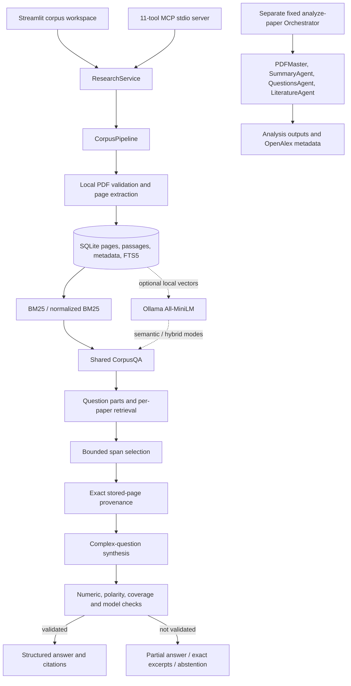
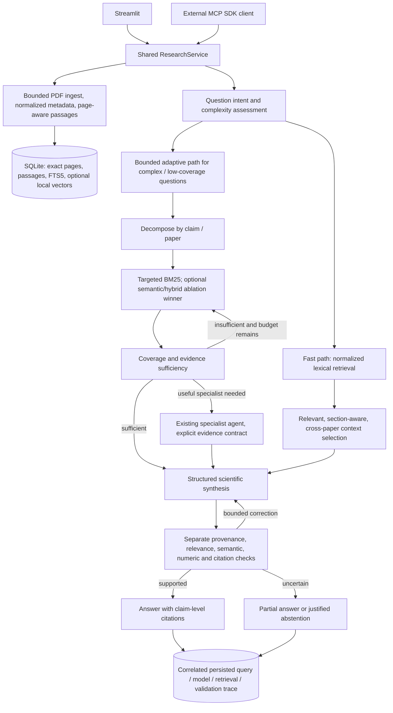

# Final architecture: verified current state and target

This document distinguishes the running architecture from the still-unmet target. The target is incremental and retains SQLite/FTS5, Ollama, Streamlit, MCP, and the existing specialists.

## Current verified runtime

Streamlit and MCP share corpus service, retrieval and QA logic. The original paper-analysis flow is a separate fixed orchestration path. Corpus QA does not dynamically dispatch the specialist agents.

## Target incremental architecture

## Engineering decisions

1. Keep SQLite and FTS5 as the lexical source of truth; the pilot does not justify a vector database.
2. Keep normalized BM25 with clause splitting as the current default; reconsider after human-reviewed evaluation.
3. Use embeddings locally only when indexed and measured against lexical retrieval.
4. Preserve exact page offsets and hashes. Provenance validation, topical relevance, and semantic support are distinct outcomes.
5. Keep complex-question synthesis and correction budgeted. Do not invoke every specialist or perform unbounded retrieval.
6. Treat dynamic specialist selection, query-trace persistence for all error paths, and human-grounded claim evaluation as unfinished.

Sources: [`research_swarm/corpus/`](research_swarm/corpus/), [`research_swarm/service.py`](research_swarm/service.py), [`research_swarm/mcp_server.py`](research_swarm/mcp_server.py), [`orchestrator.py`](orchestrator.py), and [`AGENTIC_RAG_ABLATION_RESULTS.md`](AGENTIC_RAG_ABLATION_RESULTS.md).
