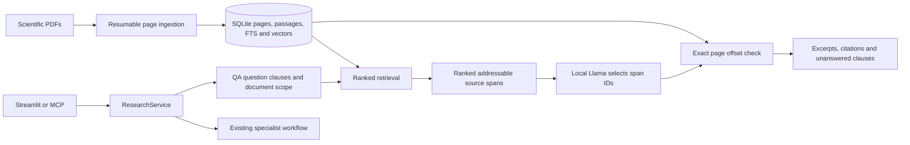

# System architecture

The original specialist workflow remains available. Corpus QA uses exact source excerpts, selected by one local model call, and the server reconstructs their citations from persistent page text.

`research_swarm/corpus/spans.py` bounds and ranks candidate sentences. `research_swarm/corpus/qa.py` builds separate per-clause options within the provider's UTF-8 budget. Exact PDF page offsets are checked after model selection. The model does not supply citation coordinates or write scientific claims in the production corpus QA path. The older draft, verify and revise path stays available in offline evaluation as `strategy="legacy"`.

The selector is controlled RAG. Its routing is deterministic and uses at most four explicit question clauses. No claim is made about live dynamic specialist routing or autonomous research. See [quality results](SCIENTIFIC_QUALITY_REPORT.md).

The design applies the whitepaper's context and harness guidance through separated instructions, bounded source options, deterministic citation checks, and reproducible feedback from recorded traces. [The New SDLC With Vibe Coding](https://reu.techconf.org/document/06-Reading-materials/The-New-SDLC.pdf)
