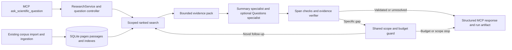

# Agentic RAG implementation plan

**Approval requested for the plan only.** The project outcome is a local MCP consumer asking a scientific question over an indexed paper collection and receiving a structured answer whose material claims resolve to page-level evidence. The acceptance demonstration must show a model-informed gap changing a retrieval decision and improving a verified answer. The existing uploaded-PDF workflow remains available.

## Current architecture and reusable components

The [architecture assessment](RAG_ARCHITECTURE_ASSESSMENT.md) traces the current entry points and includes the current diagram. Streamlit and MCP `analyze_paper` invoke the same fixed pipeline: PDF Master, indexed lexical evidence selection in FAST, Summary, Questions, then OpenAlex-based Literature. FULL maps sequential chunks. Standalone MCP summary and questions have their own text-based evidence path. The corpus CLI already searches across indexed publications, but no MCP tool asks a question across that corpus and turns retrieved spans into validated claims.

- Reuse the corpus CLI and UI for registration, resumable PDF ingestion, exact page offsets, SQLite/FTS5, BM25, and local Ollama embeddings with an exact cosine scan. Existing persisted rows should remain readable.
- Reuse the Ollama provider, `LLM.run`, Pydantic validation, Markdown loader, shared deadlines, service worker lock and stdio transport. Preserve all six MCP tools and their payloads.
- Extend the Summary specialist with a separate question-conditioned synthesis method. Reuse the Questions specialist for optional follow-on research questions where requested. Add a focused evidence verifier using the same LLM facade. PDF Master and Literature keep their existing roles. Corpus Q&A consumes already processed pages and works offline with local Ollama, without issuing OpenAlex queries.
- Preserve the existing baseline, fields, and evidence prompt assets. The [prior live report](../evaluation/EXECUTION_REPORT.md) measured summary reference recall of 38.9%, 61.1%, and 50.0% respectively on three abstracts. That pilot established a promising prompt effect and functioning MCP transport. It did not establish full-paper, retrieval, or claim validation quality.

## Target request and runtime

- **Input.** Add `ask_scientific_question` with a bounded question and optional allowlisted publication IDs. Resolve these to completed local documents inside the configured corpus. Default scope is the configured local corpus. Reject unknown explicit scope and restrict all subsequent queries to the same resolved scope. Record document versions and exclude in-progress pages. The question tool does not accept PDF paths or perform indexing.
- **Initial evidence.** Search with the question using the selected ranking policy, then pack exact spans under a shared context budget. Remove near-duplicate overlaps, retain complementary passages and paper identity, and keep conflicting results and study qualifiers visible. Track retrieved and packed ranks separately. Treat document text as data and constrain agent output to typed actions.
- **Synthesis and verification.** Produce atomic claims, each with qualifiers and supplied citation IDs. Deterministically check IDs, document checksums, page offsets and exact excerpts, and compare literal measurements where feasible. The verifier assesses support, conflicts, units and qualifiers against the cited spans. Render supported claims from the verified records so unchecked prose cannot bypass validation. Return an explicit partial or insufficient-evidence outcome when coverage fails.
- **Bounded follow-up.** An agent can request a follow-up query with claim or requested field, evidence gap and search text. The controller owns execution, authorization and budgets. Start with at most two follow-up searches total and one revision per question, bounded by the existing document deadline and explicit call and context limits. Deduplicate queries and spans. Stop on sufficient evidence, repeated requests, no new spans, errors or budget exhaustion. Revalidate revisions. Keep conflicting studies distinct by source and setting.
- **Output and trace.** Return a versioned result with run ID, status, supported claims, unresolved items, citations and warnings. Each citation includes document checksum, physical PDF page, extracted-text range, exact excerpt and catalog metadata if available. Persist the result and trace atomically in the existing output root using a distinct result type. Trace model digest, prompt fingerprint, scope, ranking, retrieved and packed span IDs, verdicts, follow-up reasons, latency and termination reason. Expose the run ID for replay from saved artifacts. Use IDs in routine logs to limit duplication of paper content.

## Phases and repository changes

| Phase | Files to change or add after approval | Exit criteria |
| --- | --- | --- |
| 0. Freeze the comparison | Add a corpus Q&A manifest and runner under `evaluation/`; extend `evaluation/score.py` or add a companion scorer for span and claim metrics. Keep the existing abstract runner reproducible. | Frozen versioned PDFs, labels, scopes, model digests, configuration, and pilot artifacts. A retrieval benchmark can replay the existing keyword and semantic paths without changing production defaults. |
| 1. Compare retrieval and implement evidence packing | `research_swarm/corpus/retrieval.py` for complete-document scoping before rank and limit, and optional rank fusion only when justified. `research_swarm/corpus/store.py` only if a shared scoped lookup is needed. Add `research_swarm/evidence_context.py` for deduplication, packing and stable references. `tests/test_corpus.py` for version/scope and ranking regressions. | Every packed span resolves exactly. No out-of-scope or incomplete documents are returned in boundary fixtures. Retrieval strategy earns its place under the comparison below. Existing corpus search remains compatible. |
| 2. Add structured, validated Q&A | `models.py` for request results, claims, citations and gaps. `agents/summary_agent.py` for scoped synthesis, and `agents/questions_agent.py` only if a grounded follow-on method is needed. Add `research_swarm/corpus_qa.py` and `research_swarm/evidence_validation.py`. Add Markdown synthesis and verification assets under `prompts/`, with prompt selection and fingerprint coverage in `tests/test_prompts.py`. | Baseline, field-based, and evidence-first variants run on identical evidence with a common schema. Wrong references, units and scope are exercised. Every citation in the returned answer resolves, and each returned material claim passes the configured support checks. Human review measures verifier errors. |
| 3. Add bounded follow-up and MCP | Extend `research_swarm/corpus_qa.py`, `research_swarm/service.py`, `research_swarm/mcp_server.py` and `research_swarm/telemetry.py`. Add settings in `config.py` and matching declarations in `research_swarm/config.pyi` if the new budgets require configuration. Add `tests/test_corpus_qa.py` and extend `tests/test_mcp.py`. | Real stdio round-trip validates the new schema. Legacy tool names and contracts remain intact. Tests exercise empty corpus, invalid scope, no gap, recoverable gap, repeated query, no new evidence, timeout, and malicious instructions in retrieved text. Every attempted follow-up has a logged reason, a scope decision and a terminal outcome. |
| 4. Evaluate and document | Extend `evaluation/mcp_smoke.py` or add a corpus-specific smoke runner. Publish configurations, labels, summaries and traces under `evaluation/`. Update `README.md`, `MCP_GUIDE.md` and `WINDOWS_RUN_GUIDE.md`. | Existing regression suite and new tests pass. A fresh local demonstration can be repeated from documented commands. Results include effect sizes, uncertainty, failures and latency. |

The existing `orchestrator.py`, corpus ingestion and UI can stay on their current paths. Changes to those files require a concrete integration need. Use SQLite and the existing local Ollama runtime throughout.

## Scientific evaluation and selection gates

Follow the [evaluation plan](RAG_EVALUATION_PLAN.md) for source labels, blinded annotation, metric definitions and reproducibility. Expand the experimental unit to frozen question/corpus pairs. Include single-paper answers, multi-paper comparisons, exact identifiers, paraphrases, conflicting findings and unanswerable questions. Keep publication families together across development and held-out splits and resolve gold evidence in physical-page coordinates. Score comparative answers for both sides of the comparison and their experimental qualifiers.

1. **Measure shipped retrieval first.** Replay shipped corpus BM25 on natural questions without generation, with shipped local semantic search as a comparator. Also retain the prior fixed FAST selector as a single-PDF reference. Compare to scoped, field-aware lexical queries and rank fusion over the same completed corpus, matched final context budget and equal candidate cutoffs. Report Precision@k and Recall@k for ranks and packed evidence, evidence relevance, vector coverage, cold indexing cost and warm p95. Test paraphrases independently of exact identifiers.
2. **Isolate advanced prompting.** Use identical packed spans and a common typed schema for baseline-style instructions, fields, and evidence-first. Preserve the earlier extraction baseline separately. Compare scientific claim accuracy, correct applicable-field recall, citation correctness and coverage, evidence relevance and unsupported-claim rate. Evaluate research-question usefulness separately if the optional follow-on mode is enabled. Compare draft-only, checks-only, same-context revision, and gap-driven retrieval plus revision to isolate new evidence.
3. **Freeze gates before held-out scoring.** Proposed minimum worthwhile effects are +5 percentage points packed evidence recall with no more than 2 points precision loss for a more complex retriever, and +5 points correct applicable-field recall for advanced prompts with no more than 2 points factual accuracy loss. Target a 5-point drop in unsupported claims from validation and correction with no more than 2 points completeness loss. These are proposed targets, not measurements. Agree on a local p95 budget on development hardware. Use paired paper-cluster intervals and report inconclusive results. Keep lexical as default unless the evidence supports semantic or hybrid adoption. Missing vectors, scan limits and fallback must be visible in experiment results.
4. **Verify the agentic behavior directly.** Require a held-out trace where a model-informed gap yields new evidence and corrects or completes a supported claim. Record false triggers, budget compliance, unresolved cases, and the aggregate quality and latency effect. A trace proves the behavior occurred. The paired evaluation determines how reliably it helps.

Pin the corpus, git revision, chunk profile, hardware, Ollama version and model digests, prompt fingerprints, budgets and generation parameters. Turn off model response caching for quality runs and use clean run artifacts. Report cold and warm comparisons separately, rotate run order, and adjudicate outputs without arm labels. The Google engineering reference informs the plan's explicit interfaces, context budgets, verification harness and approval checkpoints. [The New SDLC With Vibe Coding](https://www.kaggle.com/whitepaper-the-new-SDLC-with-vibe-coding) · [Whitepaper PDF copy](https://reu.techconf.org/document/06-Reading-materials/The-New-SDLC.pdf)

## End-to-end demonstration

1. Use the existing corpus CLI to import the version-pinned Transformer and LoRA PDFs from the evaluation manifest and run resumable ingestion to completion. Verify their checksums and page counts, then restart the process to demonstrate persistence.
2. Start the existing stdio server against the same corpus root and call `ask_scientific_question` from a real SDK client. Ask how the Transformer paper motivates self-attention and how LoRA changes which parameters are trained during adaptation, with a source for each. Expect separately attributed, cited claims and explicit qualifications. Resolve each citation locally using checksum, page and offsets.
3. Use a documented tight initial evidence budget on the same corpus or a frozen comparison case to expose a missing subanswer. Inspect the model's gap request, the bounded follow-up, newly packed spans and the revalidated response. Replay the same case with follow-up disabled and compare both outputs against gold spans. Do not count a simulated retrieval trace as live evidence.
4. On these same PDFs, ask for a head-to-head finding absent from the indexed sources. Expect a partial or insufficient-evidence status and a logged stop reason. In the same integration check run the existing `analyze_paper` and `get_analysis_result` path to verify compatibility. Capture the raw responses, local traces, checksums, metrics and reproduction commands.

Approval covers the phases above. Retrieval strategy, thresholds and loop defaults remain subject to the measured gates.
