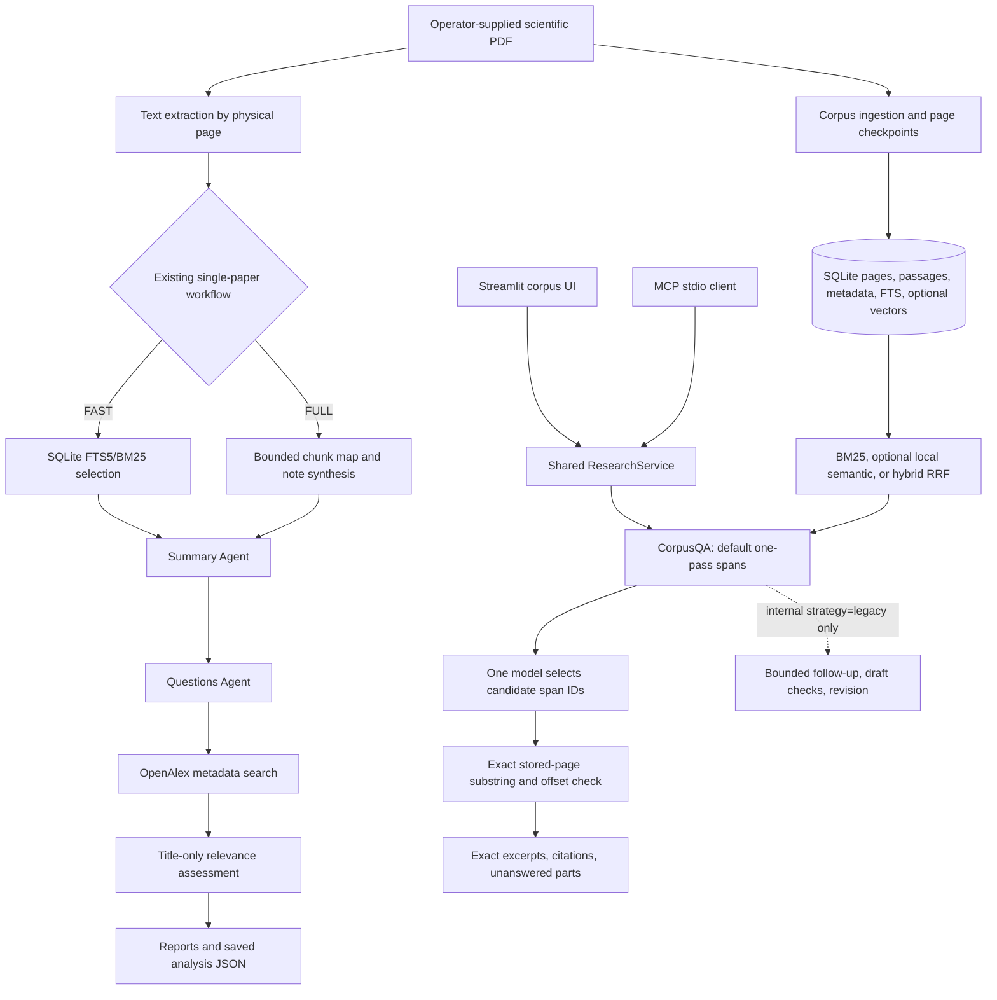

# Independent Master Audit: Scientific Agentic RAG

**Assessment date:** 18 November 2026  
**Scope:** Current repository source, existing tests and saved evaluation artifacts. This audit changes no application code, prompts, tests, labels, or experiment results.

## Executive verdict

| Question | Finding |
|---|---|
| Is the current system a RAG system? | **Yes, with distinct runtime paths.** FAST research and corpus QA retrieve source passages before model use. The corpus separately offers BM25, local Ollama semantic retrieval, and hybrid reciprocal-rank fusion. FULL research is bounded map/reduce rather than ranked retrieval. |
| Is it already an Agentic RAG system? | **Not in the normal end-to-end user path.** The current Streamlit/MCP corpus-QA path uses one-pass `spans` selection. A bounded follow-up/revision/verification strategy exists in `CorpusQA`, but normal callers do not select it. The fixed four-specialist workflow has no evidence-driven routing loop. |
| What works? | Local PDF ingestion, persistent SQLite corpus/index, page/offset provenance, lexical retrieval, optional local embeddings, hybrid retrieval, Markdown prompts, specialized agents, MCP stdio tools, bounded operations, and regression coverage. |
| What is missing or not proven? | Reliable claim-level scientific support, public evidence-driven follow-up, useful/reproducible quality gains, broad independent evaluation, consistent retrieval/coverage contracts, and end-to-end trace persistence. OCR and robust table/figure extraction are also absent. |
| What should happen next? | Preserve the existing architecture; establish a frozen, paper-level held-out evaluation; compare retrieval and QA variants under matched context and runtime budgets; then expose a bounded feedback path only if it improves measured quality. |
| Can this audit claim the final system is better? | **No.** Current saved pilots are useful diagnostics, not sufficient comparative scientific evidence. |

This conclusion is grounded in the default strategy and call paths in [CorpusQA](../research_swarm/corpus/qa.py#L85-L160), [ResearchService](../research_swarm/service.py#L98-L105), [MCP tools](../research_swarm/mcp_server.py#L67-L95), and the fixed [Orchestrator](../orchestrator.py). Existing analyses in [the RAG assessment](RAG_ARCHITECTURE_ASSESSMENT.md) and [the gap analysis](AGENTIC_RAG_GAP_ANALYSIS.md) were reused and reconciled with current source and newer `span-engineering-release` evidence.

## Scope, evidence, and limitations

Reviewed current runtime code for PDF extraction, ingestion, chunking, SQLite persistence, retrieval, prompt loading, model/provider calls, agent orchestration, MCP, Streamlit corpus QA, budgets, and telemetry. Read relevant tests and prior architecture/acceptance documents. Inspected saved artifacts including the current `span-engineering-release` SDK responses, case review, benchmark, JUnit XML, hardware snapshot, and corpus checks.

Evidence classes are kept separate:

1. **Source-verified:** behavior directly visible in current source; references below point to the source files.
2. **Saved-run evidence:** a specific prior execution recorded in a named artifact; it was not re-run for this audit.
3. **Test evidence:** automated tests and saved test output establish contracts and regression behavior, not scientific accuracy.
4. **Not independently verified:** current Git/remote state, a fresh full suite, fresh live model/OpenAlex calls, and whitepaper details. A previous attempt to inspect environment state and a previous web fetch were denied; neither was retried. No local copy of the named Google whitepaper was found, so this report does not claim to have consulted it.

The saved JUnit report records **164 passed, 0 failed, 0 skipped** in 58.297 seconds (`evaluation/results/span-engineering-release/pytest.xml`). This is a saved report, not a fresh run in this audit. `FINAL_ACCEPTANCE_REPORT.md` records an earlier 163-test run and legacy QA outcomes. Those historical outputs must not be merged with the newer span-QA run: current MCP and UI callers omit `strategy`, and current `CorpusQA.ask` defaults to `spans`. In particular, the prior legacy draft/verify/revision traces are not evidence of the current public default.

## Current architecture

The diagram distinguishes two evidence paths. The original analysis workflow uses a fixed, configured controller. FAST uses its existing source-selection route; FULL maps chunks and synthesizes bounded notes. The separate persistent corpus exposes selectable BM25, semantic, and hybrid search. Normal UI/MCP corpus QA defaults to exact source-span selection; its internal `legacy` path is not routed by those callers. OpenAlex supplies paper metadata and title-only assessments, not retrieved full text for verifying the manuscript's claims.

## Component assessment

| Target component | Status | Repository evidence and finding |
|---|---|---|
| Scientific PDF ingestion | **Working with limits** | `PDFMaster` extracts readable physical pages with byte/page checks and warns for blank/unreadable pages. Corpus ingestion validates/stores supplied PDFs, checks their SHA-256, and checkpoints pages. No OCR is implemented. [PDFMaster](../agents/pdf_master.py) · [ingest](../research_swarm/corpus/ingest.py) |
| Document preprocessing | **Partial** | PyMuPDF text extraction is sorted by page coordinates; headings and paragraph boundaries are heuristically detected. Scanned pages, table structure, formulas, figures, and reading-order fidelity are not guaranteed. [PDFMaster](../agents/pdf_master.py) · [ingest](../research_swarm/corpus/ingest.py) |
| Metadata extraction | **Partial** | The corpus accepts operator-supplied title/DOI and stores author/year fields; it does not automatically verify bibliographic metadata from the paper. OpenAlex fields describe discovered works. [CorpusStore](../research_swarm/corpus/store.py) · [LiteratureAgent](../agents/literature_agent.py) |
| Chunking | **Working with limits** | Page passages preserve offsets, use bounded character size/overlap, and keep heuristic section labels. Sentence-based answer candidates add another heuristic layer. [ingest](../research_swarm/corpus/ingest.py) · [span ranking](../research_swarm/corpus/spans.py) |
| Page-level provenance | **Working for stored text** | QA resolves the selected quote to exact stored page text and returns document/page/hash/offset metadata. This verifies provenance to ingested text, not the scientific entailment of a selected excerpt. [CorpusQA](../research_swarm/corpus/qa.py#L64-L83) |
| Document indexing and persistence | **Working** | SQLite persists publications, documents, pages, passages, FTS, optional vectors, checkpoints, and retrieval history. [CorpusStore](../research_swarm/corpus/store.py) |
| Lexical retrieval | **Working** | SQLite FTS5/BM25 literalizes user terms and applies document scope before top-k. [retrieval](../research_swarm/corpus/retrieval.py#L92-L118) |
| Semantic retrieval and embeddings | **Implemented, optional** | Local Ollama embeddings are model-identified, persisted, and cosine-scanned with a configurable cap. Embeddings must be indexed first; a scan over the cap fails explicitly. This is not an ANN index. [retrieval](../research_swarm/corpus/retrieval.py#L14-L84) · [semantic search](../research_swarm/corpus/retrieval.py#L156-L199) |
| Hybrid retrieval | **Implemented, unproven advantage** | RRF fuses lexical and semantic top candidates. It is selectable in corpus search, not a demonstrated quality upgrade for the whole agent workflow. [hybrid search](../research_swarm/corpus/retrieval.py#L202-L225) |
| Relevant context selection | **Partial** | Corpus QA decomposes questions heuristically, ranks sentences by lexical overlap, balances candidate snippets across parts, and asks one model to select IDs. It does not independently verify relevance/entailment on the default route. [spans](../research_swarm/corpus/spans.py#L31-L79) · [QA](../research_swarm/corpus/qa.py#L101-L160) |
| Context engineering | **Partial but concrete** | Markdown safety/schema instructions, structured evidence packets, and conservative byte budgets are present. The packed options remain heuristic; no measured context-relevance or diversity guarantee exists. [QA](../research_swarm/corpus/qa.py#L36-L61) · [prompts](../prompts/README.md) |
| External Markdown prompts | **Implemented** | `prompt_loader` loads editable Markdown, supports variants and fingerprints. Agent instructions, safety, and evidence templates are external. JSON Schema is generated from Python model types rather than hand-authored prompt text. [loader](../research_swarm/prompt_loader.py) · [prompts](../prompts) |
| Specialized agents | **Working** | PDF, Summary, Questions, and Literature agents are retained and called by the existing workflow. [agents](../agents) |
| Agent orchestration | **Fixed workflow, not autonomous routing** | The Orchestrator executes a fixed sequence; corpus QA is separately exposed. No runtime model selection of agents/tools occurs in the normal workflow. [Orchestrator](../orchestrator.py) |
| Evidence-grounded generation | **Partial** | Main agents receive source text/selected evidence and prompts, but their prose is not claim-linked to verified spans. Default corpus QA returns exact excerpts rather than synthesizing a fully supported answer. [SummaryAgent](../agents/summary_agent.py) · [CorpusQA](../research_swarm/corpus/qa.py) |
| Claim/citation validation | **Partial and path-dependent** | Default spans verifies that a selected span maps exactly to a stored page. `legacy` additionally validates quote provenance/numeric tokens and asks a model verifier, but it is not the public default and model verification is not independent ground truth. [QA](../research_swarm/corpus/qa.py#L64-L83) · [legacy strategy](../research_swarm/corpus/qa.py#L166-L218) |
| Bounded correction and feedback | **Internal prototype only** | `legacy` has at most two attempts and a possible model-proposed follow-up/revision. Default spans retrieves once per deterministic query part; the main Orchestrator has no evidence-driven return edge. [QA](../research_swarm/corpus/qa.py#L85-L98) · [MCP QA](../research_swarm/mcp_server.py#L91-L95) |
| Structured scientific outputs | **Partial** | MCP exposes typed summaries/questions/literature/analysis models. Corpus QA returns a structured status, claims, citations, trace, and unanswered parts, but main summary claims do not have a claim-to-source contract. [models](../models.py) · [MCP](../research_swarm/mcp_server.py) |
| Persistent storage | **Working for corpus and analysis** | SQLite stores corpus data; completed analysis is saved under a validated run ID. Corpus QA response traces/results are returned to the caller but are not stored as durable QA records. [store](../research_swarm/corpus/store.py) · [service](../research_swarm/service.py#L140-L172) |
| MCP integration | **Implemented, local stdio** | Source registers 11 typed tools and calls the shared service. Tests and saved artifacts include an external stdio client. It is not a remote authenticated service. [MCP server](../research_swarm/mcp_server.py#L21-L95) · [MCP tests](../tests/test_mcp.py) |
| Automated tests | **Strong plumbing coverage; not quality proof** | Current saved JUnit lists 164 passing tests. QA tests cover exact offsets, injection fixtures, and the internal legacy branch. Mocked cases do not establish live model accuracy. [QA tests](../tests/test_corpus_qa.py) · [JUnit](../evaluation/results/span-engineering-release/pytest.xml) |
| Scientific evaluation | **Pilot only** | A small fixed benchmark and developer-reviewed live cases exist. The current corpus contains three pinned scientific PDFs plus a synthetic canary; paper-level generalization and independent judgments are not established. [benchmark](../evaluation/span_benchmark.py) · [review](../evaluation/results/span-engineering-release/review.json) |
| Observability | **Partial** | Successful QA returns retrieval/provided span traces, selected IDs, prompt fingerprint, and duration; retrieval history stores query/mode/evidence IDs. QA output is not durably recorded and the MCP wrapper maps unexpected errors to generic tool failures. [QA](../research_swarm/corpus/qa.py) · [store](../research_swarm/corpus/store.py) · [MCP wrapper](../research_swarm/mcp_server.py#L21-L35) · [telemetry](../research_swarm/telemetry.py) |

## Findings and severity

Severity describes importance to the requested scientific-RAG objective, not exploitability.

### F-01 — High: exact provenance is not scientific support

The default path verifies that the excerpt is an exact substring of the stored PDF page and labels its relevance as `model_selected`. It does not perform an independent entailment/claim check. Consequently, `supported_claims` can overstate what has actually been established: the emitted item is a source excerpt selected as relevant, not a validated synthesized answer. The current developer review classified the LoRA limitation response as incorrect and the false-premise response as partial, despite exact citations. This is a correctness/UX contract issue; preserve the current cautious coverage wording and do not treat citation resolution as factual verification.

Evidence: [default QA implementation](../research_swarm/corpus/qa.py#L101-L160), [case review](../evaluation/results/span-engineering-release/review.json), [saved QA responses](../evaluation/results/span-engineering-release/mcp-acceptance.json).

### F-02 — High: Agentic behavior is not in the normal end-to-end route

MCP and Streamlit call `ask_corpus` without a strategy argument; its default is `spans`. The internal legacy path has bounded follow-up and model verification, but the four-agent workflow does not call it. The project is RAG, but should not be represented as a user-facing Agentic RAG system on the basis of an internal branch or fixed sequential orchestration.

Evidence: [QA default](../research_swarm/corpus/qa.py#L85-L98), [service call](../research_swarm/service.py#L98-L105), [MCP tool](../research_swarm/mcp_server.py#L91-L95), [Orchestrator](../orchestrator.py).

### F-03 — High: scientific quality evidence is too small for a reliability claim

The latest saved review covers eight cases: five of seven answerable probes were fully correct, one answerable limitation case was incorrect, one misleading-premise case was partial, and the one unanswerable probe was correctly abstained. All returned citations checked against PDF source spans, which establishes provenance, not full support. The reviewer is a developer-run pilot; the benchmark uses three papers and six fixed questions, with query-level development/held-out labels rather than a paper-level held-out corpus. This is diagnostic evidence, not a general accuracy claim.

Evidence: [review](../evaluation/results/span-engineering-release/review.json), [quality report](../SCIENTIFIC_QUALITY_REPORT.md), [benchmark fixtures](../evaluation/span_benchmark.py#L11-L27).

### F-04 — Medium: hybrid/semantic retrieval has no established quality win

Keyword, semantic, and hybrid modes work, but their scientific effect is not established. A five-query earlier pilot reported answerable mean Precision@5/Recall@5/MRR/latency of keyword `0.20/0.708/0.583/0.040s`, semantic `0.15/0.50/0.313/0.113s`, and hybrid `0.20/0.75/0.458/0.170s`. This small sample suggests higher recall for hybrid than keyword, but not better MRR, and higher latency. The newer six-query benchmark records top-10 target recall, not full precision/recall or statistically reliable gains. There is no basis to add a vector database or make hybrid the universal default.

Evidence: [earlier retrieval pilot](../evaluation/results/corpus-retrieval-live.json), [newer paired benchmark](../evaluation/results/span-benchmark-release.json), [retrieval implementation](../research_swarm/corpus/retrieval.py).

### F-05 — Medium: extraction and candidate ranking can omit scientific evidence

PDF processing is text-only. Image/scanned content is explicitly unsupported; table/formula reconstruction is absent. Heading detection, sentence boundaries, focus terms, directive filtering, and overlap rules are heuristics. The pipeline therefore has foreseeable omissions for tables, equations, abbreviations, multi-column reading order, and paraphrased questions. This is a bounded feature gap, not evidence that current indexed text is corrupted.

Evidence: [PDFMaster](../agents/pdf_master.py), [passage ingestion](../research_swarm/corpus/ingest.py), [candidate ranking](../research_swarm/corpus/spans.py).

### F-06 — Medium: traces and errors are not a durable end-to-end evaluation record

Successful corpus QA returns a trace and retrieval history records search IDs, but QA answers, selected spans, prompt/model identity, validation outcome, and failure reason are not persisted together as a query record. Unexpected MCP exceptions become generic tool errors. This makes live failures harder to compare and can leave only partial external harness logs.

Evidence: [QA response](../research_swarm/corpus/qa.py#L143-L160), [retrieval history schema](../research_swarm/corpus/store.py#L45-L56), [MCP error boundary](../research_swarm/mcp_server.py#L21-L35).

### F-07 — Low: operator documentation is behind the MCP surface

Current source registers 11 tools, while [MCP_GUIDE.md](../MCP_GUIDE.md) still says “All six tools” and documents only the initial specialist API. This can mislead MCP consumers about corpus ingestion/search/QA capabilities and their current limits. This audit does not edit the guide.

Evidence: [current server](../research_swarm/mcp_server.py#L37-L95), [guide](../MCP_GUIDE.md#L1-L45), [MCP test](../tests/test_mcp.py).

## Security review

The scoped security review found **no confirmed exploitable vulnerabilities** in the reviewed code. This is not a penetration test or a guarantee about deployment configuration. Source includes local-root path containment, PDF bounds, parameterized SQL, loopback-only Ollama configuration, disabled redirects, and provider authorization checks. The MCP server is local stdio without multi-user authentication; do not expose it as a shared remote service without a separate threat model and authentication/authorization layer. Multiple server processes do not share the in-process worker lock.

| # | Severity | File | Lines | Vulnerability | Confidence |
|---|----------|------|-------|---------------|------------|
| — | — | — | — | No confirmed vulnerabilities identified by the scoped review; this is not a penetration test. | — |

## Original requirements

1. **Externalize agent prompts to Markdown — implemented.** The loader reads files from `prompts/`; variants and prompt fingerprints support controlled changes. Preserve baseline assets for reproducibility. [loader](../research_swarm/prompt_loader.py) · [prompts](../prompts)
2. **Advanced prompting and experiments — implemented, improvement not established.** Baseline/fields/evidence variants and saved experiments exist. The paired live pilot on one abstract did not consistently improve supported claims, question usefulness, or latency. The current QA span selector is another strategy, not proof of quality gains. [prompt results](../FINAL_EXPERIMENT_RESULTS.md)
3. **MCP server invoking agents and exposing scientific information — implemented.** The official Python SDK stdio server calls the existing service and has 11 tools for specialist and corpus workflows. Local persistence and source inspection are supported. Scientific QA quality and remote multi-user serving are separate, unproven requirements. [server](../research_swarm/mcp_server.py) · [service](../research_swarm/service.py)

## Reproducible scientific evaluation plan

### Freeze and label the benchmark first

- Use the same pinned PDF bytes and SHA-256 for every arm. Store versioned question text, expected answer facets, supporting page/span labels, valid paraphrase forms, and explicit unanswerable/false-premise cases.
- Split by **paper**, not only by question. Keep an untouched held-out set and do not tune prompts, chunking, or ranking on it.
- Include numeric results, methods, limitations, negative results, tables, multi-part questions, cross-paper comparisons, misleading premises, injection text, and questions whose evidence is absent.
- Have at least two reviewers independently judge claim support, evidence relevance, completeness, citation correctness, and question usefulness; adjudicate disagreements and record agreement. Do not treat model-as-judge output as independent ground truth.

### Compare matched arms

| Factor | Controlled arms |
|---|---|
| Baseline | Existing analysis baseline / current prompt and retrieval behavior, with coverage clearly labelled |
| Retrieval | Current lexical strategy; existing semantic strategy; existing hybrid RRF; any proposed improved ranking only after retrieval-only evaluation |
| Prompting | Baseline Markdown prompt; advanced/fields prompt; evidence-first prompt |
| Validation/correction | No added validator; exact provenance-only; provenance plus bounded claim validation; bounded follow-up/revision with the same scope and attempt budget |

Run all applicable arms on identical documents/questions. Hold the model build/digest, prompt version, temperature, context/output limits, retrieval candidate limit, document scope, and cache policy constant. Disable caches for comparisons, run serially on the recorded local Ollama device, randomize arm order, and use repeated trials for live inference. Record retrieval and generation separately so increased latency or context cannot be mistaken for a quality gain.

### Report these metrics

- **Retrieval:** Precision@k, Recall@k, MRR, and target-span rank; report answerable and unanswerable queries separately.
- **Answer quality:** claim-level factual accuracy, extraction completeness against labeled facets, and research-question usefulness/category correctness.
- **Evidence:** relevance judged against the question, exact citation/page/offset correctness, and semantic support of each cited claim as separate measures.
- **Safety/correctness:** unsupported-claim rate, false-accept rate on unanswerable/false-premise questions, and correct-abstention rate.
- **Operations:** retrieval-only, model-call, and end-to-end latency (median and p95); timeout/error rate; prompts/tokens and hardware/model identity.
- **Analysis:** paired per-question deltas and confidence intervals; publish the raw per-case outputs and reviewer labels. Pre-register acceptance thresholds before running the held-out set.

The present six-question benchmark has useful source anchors, but its `top10_target_recall` alone does not measure candidate precision, answer entailment, or human relevance. A sensible next experiment is not a new database: first compare the existing retrieval modes on a paper-level held-out, human-labeled query set; then pass the same top-k evidence into each prompt/validation arm.

## Recommended implementation sequence

This is an approval-gated recommendation, not authorization to modify application code.

1. **Reconcile documentation and evidence versions.** Update the stale MCP guide and mark older acceptance outputs as historical, without deleting raw results. Identify the exact source revision and model/config for each future experiment.
2. **Expand and freeze the evaluation set.** Add paper-level held-out documents and adjudicated labels before changing ranking or prompts.
3. **Measure retrieval only.** Compare current BM25, semantic, and RRF hybrid using the same scope/top-k; adopt a change only if paired retrieval metrics improve within a documented latency budget.
4. **Measure answer selection and support.** Compare current default span selection with exact-provenance and independent adjudication measures. Clarify API status semantics so source provenance is not presented as claim entailment.
5. **Expose bounded adaptive retrieval only if it wins.** Reuse the internal strategy rather than adding a second agent framework. Keep document scope fixed, cap follow-ups, stop on no new evidence/repeated query/deadline, preserve abstentions, and persist the trace.
6. **Revisit structured scientific claims and broader source extraction.** Consider claim-to-span contracts for the existing agents and add OCR/table handling only if the held-out dataset shows these are material failures.

No vector database, cloud service, framework rewrite, or independent per-agent unrestricted retrieval is justified by current evidence.

## Final conclusion

The repository already contains **conventional RAG capabilities**, including a persistent scientific-document corpus, exact page provenance, FTS5/BM25 retrieval, optional local Ollama semantic embeddings, and hybrid RRF retrieval. The system should **not yet be described as a user-facing Agentic RAG**: its normal corpus QA is a one-pass, model-selected exact-span path, and the original orchestration is fixed-order. A bounded adaptive QA strategy exists internally but has not been demonstrated as a reliable public workflow.

The immediate gap is **not missing vector infrastructure**. It is verified scientific support and controlled evaluation: retrieval improvements must be measured, exact source provenance must remain distinct from entailment, and any bounded correction loop must improve held-out answer quality without unacceptable false claims, latency, or regressions.
