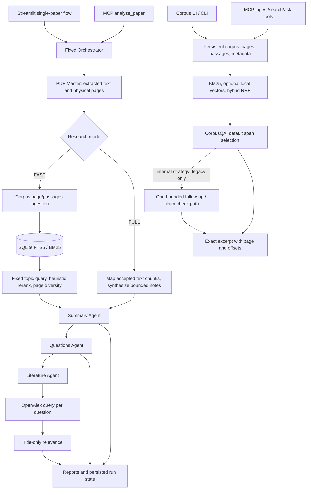

# RAG architecture assessment

**Verdict.** The project is a RAG system, with separate lexical, local semantic, and reciprocal-rank-fusion hybrid retrieval over a persistent local PDF corpus. Its default FAST analysis is conventional, single-document lexical RAG; FULL and standalone agent calls use different context paths. The corpus Q&A code also contains a bounded adaptive follow-up/verification strategy, but the normal UI and MCP tool call the one-pass `spans` strategy. Thus the product is **not Agentic RAG by default**; an internal, opt-in prototype path has Agentic RAG behavior. See the [gap analysis](AGENTIC_RAG_GAP_ANALYSIS.md).

## Current runtime

The Streamlit job and MCP `analyze_paper` share [Orchestrator](../orchestrator.py), which calls [select_corpus_evidence](../research_swarm/summary_work.py) in FAST. This path ingests the uploaded PDF, performs an FTS5/BM25 search using a fixed topical query, then applies fixed term/section scoring, page diversity and a byte budget. A no-hit fallback selects initial passages in document order. FULL maps accepted sequential text chunks and synthesizes selected bounded notes. Standalone MCP summary/questions call agents directly through [ResearchService](../research_swarm/service.py), without using the corpus selector.

The separate corpus UI/CLI and MCP corpus tools expose keyword, local semantic, and hybrid retrieval; hybrid uses reciprocal rank fusion. The separate [CorpusQA](../research_swarm/corpus/qa.py) defaults to deterministic question decomposition, retrieval, span ranking, and model selection of exact excerpts. Its `strategy="legacy"` code can request one model-generated follow-up query, retrieve again, check source-span and numeric consistency, ask a model verifier, and make one bounded revision attempt. Current Streamlit and MCP `ask_scientific_question` callers do not pass that strategy, so they use the one-pass default. OpenAlex adds title metadata and title-only relevance in the literature stage, not full-text evidence to the earlier single-paper agents.

## Component inventory

| Component | Status and repository evidence |
| --- | --- |
| Scientific PDF ingestion | Working for readable PDFs with byte/page limits and unreadable-page warnings. Corpus ingestion uses page checkpoints and leases. [PDF Master](../agents/pdf_master.py), [ingest](../research_swarm/corpus/ingest.py) |
| Document preprocessing | Partial. Sorted page text, whitespace trimming and heuristic headings exist. Scans, image content and structured table/formula reconstruction are uncovered. [PDF Master](../agents/pdf_master.py), [ingest](../research_swarm/corpus/ingest.py) |
| Metadata extraction | Partial. Corpus supports catalogued title, DOI, authors and year. New FAST uploads can receive an unverified placeholder, and OpenAlex metadata describes discovered papers. Automatic extraction and verification of uploaded-paper bibliographic fields are missing. [store](../research_swarm/corpus/store.py), [selector](../research_swarm/summary_work.py), [literature](../agents/literature_agent.py) |
| Chunking and page-level provenance | Working at source level. Overlapping page passages carry physical page and exact character offsets. FAST manifests include document and text hashes and excerpt bounds. Generated claim-to-span linkage needs work. [ingest](../research_swarm/corpus/ingest.py), [selector](../research_swarm/summary_work.py) |
| Indexing and lexical retrieval | Working. SQLite FTS5 and BM25 are used in FAST. SQL document filtering before candidate limiting and task-specific queries merit testing. [store](../research_swarm/corpus/store.py), [retrieval](../research_swarm/corpus/retrieval.py) |
| Semantic retrieval and embeddings | Implemented as a separate corpus capability. Local Ollama embeddings are stored by model identity and searched by bounded exact cosine scan over normalized vectors. FAST analysis never calls it. [retrieval](../research_swarm/corpus/retrieval.py), [corpus CLI](../research_swarm/corpus/__main__.py) |
| Hybrid retrieval | Implemented in corpus search as reciprocal rank fusion of BM25 and local semantic rankings. It is selectable in the corpus UI/MCP, but is not used by the default FAST Orchestrator. Ranking quality has not been measured on labelled scientific questions. [retrieval](../research_swarm/corpus/retrieval.py), [corpus UI](../research_swarm/corpus/ui.py) |
| Relevant context selection and context engineering | Partial. FAST analysis uses a fixed topical query, heuristic reranking, one excerpt per page and a byte budget. CorpusQA has a separate query-conditioned span-ranking/packing path. Neither is field-complete by measurement; the adaptive QA strategy is not exposed by normal callers. FULL uses bounded map/synthesis. [selector](../research_swarm/summary_work.py), [span ranking](../research_swarm/corpus/spans.py), [QA](../research_swarm/corpus/qa.py) |
| External Markdown prompts | Implemented for agent instructions, evidence templates, safety and schema instructions. The loader chooses versions and falls back to baseline assets. JSON Schema is generated from Python models. [prompts](../prompts/README.md), [loader](../research_swarm/prompt_loader.py), [provider](../providers.py) |
| Specialized agents and orchestration | Working. PDF Master, Summary, Questions and Literature run under a fixed controller. A generated OpenAlex query is adaptive input to one stage. [Orchestrator](../orchestrator.py), [literature](../agents/literature_agent.py) |
| Evidence-grounded generation | Partial. Main agents receive source excerpts or source-derived notes with Markdown grounding instructions. CorpusQA's normal span mode returns exact source excerpts. The existing prompt experiment found no correctly resolving summary page citations; excerpts do not alone prove support. [execution report](../evaluation/EXECUTION_REPORT.md), [QA](../research_swarm/corpus/qa.py) |
| Claim and citation validation | Partial and isolated to CorpusQA. The span path resolves model-selected excerpts to exact page offsets; the legacy path additionally checks verbatim quotes, numeric tokens and model-assessed support. This validation is not applied to Orchestrator summaries/questions, and the semantic checker is not independent ground truth. [QA](../research_swarm/corpus/qa.py), [models](../models.py) |
| Bounded correction and feedback | Prototype exists only in CorpusQA `strategy="legacy"`: at most two draft attempts, optional model-proposed follow-up retrieval, and one same-context revision path. Streamlit/MCP defaults do not select it; the four-agent Orchestrator has no evidence-driven return edge. [QA](../research_swarm/corpus/qa.py), [MCP server](../research_swarm/mcp_server.py), [Orchestrator](../orchestrator.py) |
| Structured scientific outputs | Partial. MCP has typed source pages, questions, literature and coverage, but summary is free text, question evidence is a string and methods/results/limitations lack a typed claim contract. [models](../models.py) |
| Persistent storage | Working. Corpus SQLite stores pages, passages, vectors and retrieval history. Summary journal, response cache and saved run artifacts persist independently. [store](../research_swarm/corpus/store.py), [journal](../research_swarm/summary_work.py), [cache](../cache.py), [service](../research_swarm/service.py) |
| MCP integration | Implemented in source for existing agent operations plus five corpus ingest/list/search/inspect/question tools: eleven decorated tools total. The saved live report predates those five corpus tools and only verifies the original six. Normal MCP `ask_scientific_question` calls the one-pass strategy. [server](../research_swarm/mcp_server.py), [service](../research_swarm/service.py), [test](../tests/test_mcp.py) |
| Automated tests | Tests cover persistent page ingestion, exact passage resolution, mocked local embeddings, hybrid scope filtering, QA span selection and the explicit legacy follow-up/check path. These tests establish contracts, not scientific effectiveness. Existing reports cite 155 and 161 passing tests at different verification points; this assessment did not rerun them. [tests](../tests/test_corpus.py), [QA tests](../tests/test_corpus_qa.py), [reports](../evaluation/EXECUTION_REPORT.md) |
| Scientific evaluation | Prompt pilot exists for three abstracts, multiple prompt variants and hash-bound analyst review. It does not evaluate BM25/semantic/hybrid rankings or CorpusQA claim correctness on held-out full papers. Independent human review and a frozen retrieval gold set are missing. [runner](../evaluation/run.py), [execution report](../evaluation/EXECUTION_REPORT.md) |
| Observability | Partial. Retrieval history stores queries/modes/evidence IDs; CorpusQA returns per-query traces, rejected claims and duration. Main run progress/provider metrics exist, but there is no consistent correlated trace linking retrieved, packed and validated evidence across the full Orchestrator path. [store](../research_swarm/corpus/store.py), [QA](../research_swarm/corpus/qa.py), [jobs](../research_swarm/jobs.py) |

## Original requirements

1. **External Markdown prompts.** Implemented. Preserve baseline templates and prompt fingerprints so experiments remain comparable.
2. **Advanced prompting and experiments.** Implemented with limited evidence of improvement. The uncached abstract pilot reported summary reference recall of 38.9% baseline, 61.1% fields and 50.0% evidence-first. Evidence-first improved question category correctness from 0/3 to 2/3. All variants scored 0/3 for question usefulness and lacked correct resolving summary page citations. The prior audit used one analyst and three abstracts. [Final audit](../FINAL_AUDIT_REPORT.md), [execution report](../evaluation/EXECUTION_REPORT.md), [active variant selection](../prompts/selection.json)
3. **MCP server.** Implemented and now includes source extraction/analysis tools plus `ingest_paper`, `list_indexed_papers`, `search_evidence`, `inspect_evidence`, and `ask_scientific_question`. Current source/tests cover eleven tools. The saved live stdio report predates those five corpus tools and only verified six, so a fresh live compatibility run remains necessary. The previous run processed the Adam PDF, verified its 15 source pages and four selected evidence records, and reloaded saved data. Source integrity and scientific claim support require separate checks. [Server](../research_swarm/mcp_server.py), [tests](../tests/test_mcp.py), [historical execution report](../evaluation/EXECUTION_REPORT.md), [saved historical verification](../evaluation/results/verification-mcp-2026-11-17.json)

This assessment uses current source/tests and prior execution artifacts. It does not rerun live inference or the test suite and does not claim new experimental results. Prior documents report different full-suite counts (155 and 161) from separate verification runs; use their run-specific reports rather than treating those numbers as a new result here. No local copy of the named Google whitepaper was found; network retrieval was not authorized, so this assessment does not rely on or attribute findings to it.
