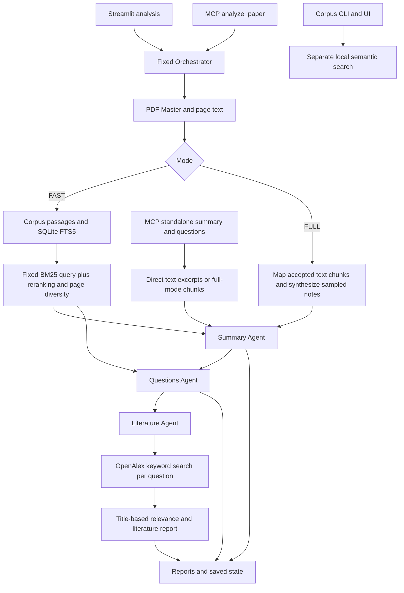

# RAG architecture assessment

**Verdict.** The full `FAST_RESEARCH_MODE` analysis is conventional, single-document lexical RAG. It indexes the submitted PDF, selects passages using a fixed query and ranking policy, and passes source excerpts to generation. If the lexical search yields no usable hits, it takes a bounded document-order sample. The system does **not** meet the Agentic RAG criterion in the [gap analysis](AGENTIC_RAG_GAP_ANALYSIS.md).

## Current runtime

The Streamlit job and MCP `analyze_paper` share [Orchestrator](../orchestrator.py), which calls [select_corpus_evidence](../research_swarm/summary_work.py) in FAST. The selector retrieves up to 32 lexical hits scoped to the publication, filters to the selected document after retrieval, reranks with fixed domain and section terms, and packs at most one excerpt per PDF page under a byte budget. It persists the selection manifest. FULL maps every accepted sequential text chunk under the maximum-chunk guard, samples bounded notes for multi-chunk synthesis, and passes the original text for single-chunk questions or a digest for multi-chunk questions. FULL is document processing followed by generation. Standalone MCP summary and questions call the agent directly via [ResearchService](../research_swarm/service.py). Their FAST path samples spread chunks without querying the index. OpenAlex adds external metadata and title-conditioned relevance in the literature stage. It provides no full-text evidence to the earlier agents.

## Component inventory

| Component | Status and repository evidence |
| --- | --- |
| Scientific PDF ingestion | Working for readable PDFs with byte/page limits and unreadable-page warnings. Corpus ingestion uses page checkpoints and leases. [PDF Master](../agents/pdf_master.py), [ingest](../research_swarm/corpus/ingest.py) |
| Document preprocessing | Partial. Sorted page text, whitespace trimming and heuristic headings exist. Scans, image content and structured table/formula reconstruction are uncovered. [PDF Master](../agents/pdf_master.py), [ingest](../research_swarm/corpus/ingest.py) |
| Metadata extraction | Partial. Corpus supports catalogued title, DOI, authors and year. New FAST uploads can receive an unverified placeholder, and OpenAlex metadata describes discovered papers. Automatic extraction and verification of uploaded-paper bibliographic fields are missing. [store](../research_swarm/corpus/store.py), [selector](../research_swarm/summary_work.py), [literature](../agents/literature_agent.py) |
| Chunking and page-level provenance | Working at source level. Overlapping page passages carry physical page and exact character offsets. FAST manifests include document and text hashes and excerpt bounds. Generated claim-to-span linkage needs work. [ingest](../research_swarm/corpus/ingest.py), [selector](../research_swarm/summary_work.py) |
| Indexing and lexical retrieval | Working. SQLite FTS5 and BM25 are used in FAST. SQL document filtering before candidate limiting and task-specific queries merit testing. [store](../research_swarm/corpus/store.py), [retrieval](../research_swarm/corpus/retrieval.py) |
| Semantic retrieval and embeddings | Implemented as a separate corpus capability. Local Ollama embeddings are stored by model identity and searched by bounded exact cosine scan over normalized vectors. FAST analysis never calls it. [retrieval](../research_swarm/corpus/retrieval.py), [corpus CLI](../research_swarm/corpus/__main__.py) |
| Hybrid retrieval | Missing. Existing keyword and semantic methods produce independent rankings. [retrieval](../research_swarm/corpus/retrieval.py) |
| Relevant context selection and context engineering | Working but limited. FAST has static domain/section ranking, page diversity and byte-bounded labelled excerpts. FULL uses bounded map/synthesis. Question context combines source or digest with summary. Neither mode gathers evidence per scientific field or adapts to gaps. [selector](../research_swarm/summary_work.py), [summary](../agents/summary_agent.py), [questions](../agents/questions_agent.py), [provider](../providers.py) |
| External Markdown prompts | Implemented for agent instructions, evidence templates, safety and schema instructions. The loader chooses versions and falls back to baseline assets. JSON Schema is generated from Python models. [prompts](../prompts/README.md), [loader](../research_swarm/prompt_loader.py), [provider](../providers.py) |
| Specialized agents and orchestration | Working. PDF Master, Summary, Questions and Literature run under a fixed controller. A generated OpenAlex query is adaptive input to one stage. [Orchestrator](../orchestrator.py), [literature](../agents/literature_agent.py) |
| Evidence-grounded generation | Partial. The model receives source excerpts or source-derived notes and grounding instructions. The November evaluation found no correctly resolving generated summary page citations. [execution report](../evaluation/EXECUTION_REPORT.md) |
| Claim and citation validation | Missing at runtime. Pydantic validates output shape, and MCP verification checked source/manifest integrity separately. Neither verifies claim support. [models](../models.py), [MCP smoke](../evaluation/mcp_smoke.py) |
| Bounded correction and feedback | Missing for scientific evidence. Deadlines, checkpoints and schema checks constrain execution, but no claim verdict drives a retrieval or revision pass. [budgets](../research_swarm/budgets.py), [Orchestrator](../orchestrator.py) |
| Structured scientific outputs | Partial. MCP has typed source pages, questions, literature and coverage, but summary is free text, question evidence is a string and methods/results/limitations lack a typed claim contract. [models](../models.py) |
| Persistent storage | Working. Corpus SQLite stores pages, passages, vectors and retrieval history. Summary journal, response cache and saved run artifacts persist independently. [store](../research_swarm/corpus/store.py), [journal](../research_swarm/summary_work.py), [cache](../cache.py), [service](../research_swarm/service.py) |
| MCP integration | Working. Six stdio tools expose existing agents and reload saved analysis. Full FAST and standalone FAST have different evidence semantics. [server](../research_swarm/mcp_server.py), [service](../research_swarm/service.py) |
| Automated tests | Established, including corpus, prompts, workflow, MCP and evaluation. Prior verification recorded 155 passes. [tests](../tests), [execution report](../evaluation/EXECUTION_REPORT.md) |
| Scientific evaluation | Pilot exists. It uses three fixed abstracts, multiple prompt variants and hash-bound analyst review. Retrieval labels, held-out full-paper cases and independent human review are missing. [runner](../evaluation/run.py), [execution report](../evaluation/EXECUTION_REPORT.md) |
| Observability | Working for progress, timing, provider metrics, cache and retrieval records. Missing correlated per-run evidence decisions, packed ranks, fallbacks and claim verdicts. [jobs](../research_swarm/jobs.py), [provider](../providers.py), [store](../research_swarm/corpus/store.py), [selector](../research_swarm/summary_work.py) |

## Original requirements

1. **External Markdown prompts.** Implemented. Preserve baseline templates and prompt fingerprints so experiments remain comparable.
2. **Advanced prompting and experiments.** Implemented with limited evidence of improvement. The uncached abstract pilot reported summary reference recall of 38.9% baseline, 61.1% fields and 50.0% evidence-first. Evidence-first improved question category correctness from 0/3 to 2/3. All variants scored 0/3 for question usefulness and lacked correct resolving summary page citations. The prior audit used one analyst and three abstracts. [Final audit](../FINAL_AUDIT_REPORT.md), [execution report](../evaluation/EXECUTION_REPORT.md), [active variant selection](../prompts/selection.json)
3. **MCP server.** Implemented. The prior live stdio check discovered six tools, processed the real Adam PDF, verified 15 source pages and four selected evidence records, and reloaded the saved result. Source integrity and scientific claim support require separate checks. [Execution report](../evaluation/EXECUTION_REPORT.md), [saved MCP verification](../evaluation/results/verification-mcp-2026-11-17.json)

This assessment uses source inspection and prior execution artifacts. It does not rerun live inference or claim new experimental results.
