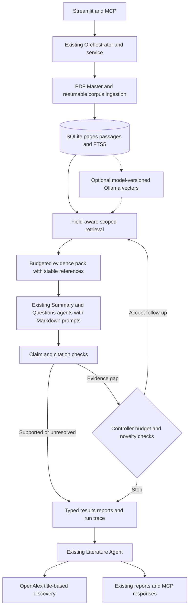

# Proposed target architecture

## Local implementation

- Reuse PDF Master, the corpus ingestion pipeline, SQLite FTS5, summary journals and the current Ollama facade. Keep FULL and current FAST available as references. Use per-document scope for extraction and explicitly authorize any future cross-document retrieval. Preserve immutable source text and provenance through all derived representations.
- Start with configurable field queries for methods, datasets, metrics, findings and limitations. Improve lexical retrieval first by filtering by document inside SQL, removing near-duplicate overlaps and packing attributable excerpts. Allow multiple distinct findings on a page when justified. Capture both retrieved and packed ranks because truncation can lose mandatory evidence.
- Evaluate existing local semantic retrieval with a complete model-versioned index for tested documents. Evaluate reciprocal rank fusion over lexical and semantic lists with pinned candidate depths, deterministic ties and common final budgets. Use rank positions rather than calibrating incomparable raw scores. Add hybrid to the analysis path only if held-out results justify the CPU, indexing, and latency costs. SQLite exact search is adequate for the proposed evaluation size.
- Use a common citation record containing PDF SHA-256, physical page, extracted-page start/end offsets, and excerpt or excerpt hash. Keep evidence IDs for local lookup and canonical spans for reproducibility. Render typed claims with field, value, unit, qualifiers, cited span IDs and status. Represent absent and ambiguous fields explicitly. Curated paper metadata can supply verified identifiers. Label any metadata inferred from PDF text as provisional.
- Verify deterministically that referenced spans were supplied, resolve against the original page, and match expected text or hash. Check literal numbers/units where possible. Assess support, directional claims, scope and qualifiers using a constrained verifier against cited spans. Treat verifier judgments as fallible and measure them against blinded human review. Preserve raw drafts for audit and distinguish structurally valid references from supported claims.
- Give Summary and Questions typed gap requests. Use a shared controller to validate scope, query length and novelty. Initial trial cap per document is two follow-up searches total and one revision, under the existing document deadline and configured request/context limits. Reserve sufficient time for validation. Final outcomes include supported, unsupported or unresolved with reasons. A revision may fix or remove unsupported claims and must be rechecked. Query retrieval only when a valid gap can be investigated.
- Extend existing run events with run ID, document and prompt fingerprints, query intent, ranking strategy and model identity, returned/packed span IDs, fallback and stop reasons, claim verdicts, call timing and cache status. Store raw scientific text with existing protected run outputs. Use identifiers in routine diagnostics where possible.
- Keep MCP stdio, existing paths and output semantics. Introduce a versioned opt-in output/tool only if needed for typed claims, evidence and trace data. Test legacy clients and new consumers. Preserve the current OpenAlex title-only scope and replay fixtures for evaluation.

The diagram describes an end state conditional on experimental gates. The [evaluation plan](RAG_EVALUATION_PLAN.md) separates retrieval quality, prompting and validation effects. The Google whitepaper informs the engineering approach through deliberate context design, a bounded harness, reproducible verification and human checkpoints. Those principles translate here into explicit evidence contracts, run traces, fixed evaluation artifacts and incremental approval. [Google whitepaper, publisher distribution](https://www.kaggle.com/whitepaper-the-new-SDLC-with-vibe-coding) · [PDF copy](https://reu.techconf.org/document/06-Reading-materials/The-New-SDLC.pdf)
