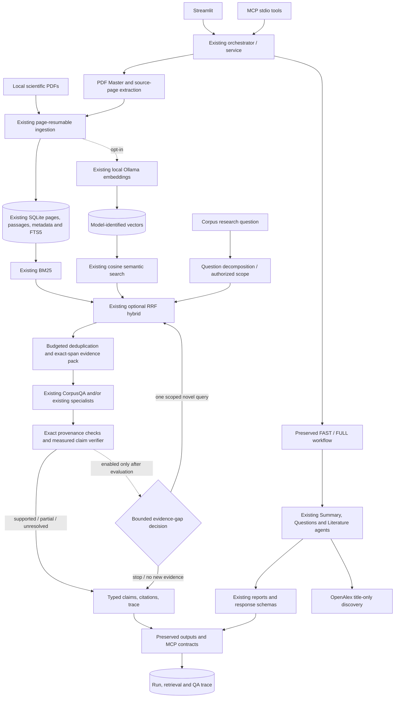

# Proposed target architecture

## Local implementation

- Reuse PDF Master, resumable corpus ingestion, SQLite FTS5, local embeddings, BM25/semantic/hybrid retrieval, `CorpusQA`, summary journals, and the current Ollama facade. No new vector database is proposed. Keep FULL, current FAST, and direct MCP agent paths unchanged as comparators. Do not copy entire cross-paper corpora into a request: use explicit document IDs and scope checks.
- Do not build another hybrid retriever: `EvidenceRetrieval.search(mode="hybrid")` already fuses lexical and semantic ranks. Measure the shipped methods first. The FAST orchestrator's fixed query and page-level heuristic are separate from that selectable corpus retriever; change its policy only after the experiment identifies a useful winner.
- Reuse the default span QA's question decomposition, ranked span selection, exact source resolution, and the legacy strategy's provenance/numeric/model checks. The immediate integration gap is that Streamlit and MCP callers use the `spans` default and cannot select the `legacy` adaptive path. If experiments support it, expose a versioned opt-in strategy rather than silently changing existing semantics. Keep follow-up retrieval/controller-owned, scoped and bounded.
- Add field-aware requests for methods, datasets, metrics, findings and limitations only where gold labels show gaps. Remove near-duplicate overlapping excerpts, preserve multiple distinct findings when needed, and record both retrieved and packed ranks. Use rank fusion with fixed candidate depths and deterministic tie-breaks; do not compare raw BM25 and cosine scores directly.
- Use a common claim citation containing PDF SHA-256, physical page, exact page-text offsets, quote/hash, and local evidence ID. Preserve current `CorpusQA` exact excerpt paths; extend typed results to atomic claims, field, units, qualifiers and supported/partial/unresolved status only after agreeing on consumer contracts. Metadata manually entered into the corpus remains operator-supplied, not extracted or independently verified.
- Keep provenance checks deterministic (selected span ID, exact quote, page bounds and source checksum). Check literal numbers/units where possible. Keep semantic support evaluation distinct and fallible; the existing `CorpusQA` verdict is model-assessed, not independent proof. Measure false accepts/rejects against blind human labels. Preserve raw drafts and distinguish citation resolution from scientific support.
- If an adaptive mode is enabled, reuse the existing follow-up logic behind a shared controller: one explicitly scoped follow-up and at most one revision for an initial trial, within the document deadline and request/context budget. Stop on repeated/no-hit queries, sufficient evidence, timeout or exhausted budget. Return unresolved gaps with reasons; revalidate any revision.
- Extend current retrieval/QA traces with run ID, corpus/document checksum, prompt and embedding-model fingerprints, search scope, strategy, candidate/packed ranks, fallback, follow-up reason, verifier outcome, latency and termination reason. Store raw scientific text in the existing protected run outputs and use IDs in routine logs.
- Preserve MCP stdio and all current tool names/contracts. Make any adaptive strategy selection explicit and test old tool callers plus saved-result reload. Keep OpenAlex title-only discovery separate from manuscript support verification.

The diagram describes an end state conditional on experimental gates, reusing capabilities that already exist. The [evaluation plan](RAG_EVALUATION_PLAN.md) separates retrieval quality, prompting and validation effects. The named Google whitepaper was not available for verification during this assessment (there is no local copy, and the web fetch was denied), so no finding is attributed to it. Revisit it if the professor's source copy becomes available; this assessment is grounded in repository source and saved test/evaluation reports.
