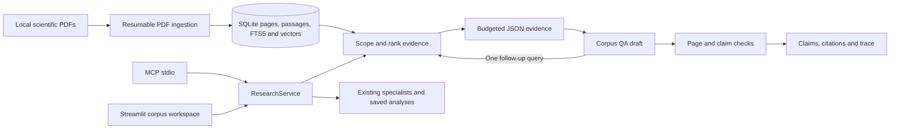

# Architecture

The original workflow accepts a PDF and invokes PDFMaster, SummaryAgent, QuestionsAgent and LiteratureAgent through Orchestrator. Its FAST path can select indexed excerpts. Its existing MCP tools expose the specialists and retrieve saved analyses. OpenAlex discovery primarily uses titles and should be read as discovery metadata.

Corpus QA has a separate output contract from the existing specialists. It can return scoped claims, a citation per claim, and a retrieval trace. See [the pipeline](RAG_PIPELINE.md) for validation details.
